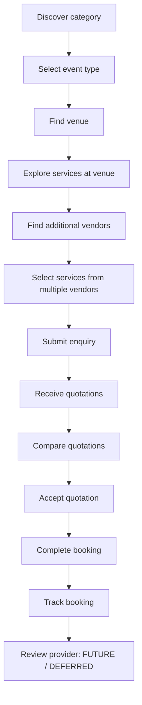

# EVNTGRID — Customer User Journeys

| | |
|---|---|
| **Source** | `main eventgrid.docx` and the owner's brief |
| **Status** | Draft for owner review |

## 1. How to read these journeys

The document does not describe any user journey. The 13 journeys below come from the owner's brief. Only the catalogue content and the source rules used within them are confirmed by the document.

| Step label | Meaning |
|---|---|
| **DOC** | Confirmed by the document. For a step about catalogue content, this confirms the content and not the screen or interaction. |
| **PROPOSED** | A proposal, not a confirmed requirement |
| **DECISION** | Cannot be finalised until the owner decides (see `CUSTOMER_REQUIREMENTS_GAPS.md`) |

## 2. End-to-end overview (proposed)

The order is proposed. Not every customer will start with a venue, for example a customer who only needs a photographer. Whether a customer can skip the venue is part of D-13.

## 3. Journeys

### J1 — Discover an event category

**Goal:** Reach the right part of the catalogue.

| # | Step | Label | Note |
|---|---|---|---|
| 1 | Customer opens EVNTGRID | PROPOSED | Homepage is not in document |
| 2 | Customer sees the 12 main categories | DOC | Content from p.1; names under D-01 |
| 3 | Customer selects a category | PROPOSED | |
| 4 | Customer sees that category's Sub Types, services or subcategories | DOC | Content from p.2–6 |
| 5 | Customer selects Surprise Events | DECISION | No content in source (D-02) |
| 6 | Customer selects Photography, Food and Catering or Venues directly | DECISION | Relationship to event-based paths (D-07) |

**Exception (proposed):** Category has no providers in the customer's area. Show a clear message and do not hide the category.

### J2 — Select event type

**Goal:** Identify the specific kind of event.

| # | Step | Label | Note |
|---|---|---|---|
| 1 | Customer selects a Wedding Sub Type (10 options) | DOC | p.2 |
| 2 | Customer selects a Meetup Sub Type (2 options) | DOC | p.3 |
| 3 | Customer selects Internal or External Corporate Event | DOC | p.5 |
| 4 | For categories with no Sub Types, customer moves on to services | PROPOSED | Birthday, Baby Shower, College/School, Outdoor |
| 5 | Event type changes which services appear | DECISION | Source does not link them (D-08) |
| 6 | Customer enters date, location and guest count | PROPOSED | |

### J3 — Find a venue

**Goal:** Choose or shortlist a place.

| # | Step | Label | Note |
|---|---|---|---|
| 1 | Venues are reachable both as a main category and as a service inside event categories | DOC | Venue is in both places in the source; navigation under D-07 |
| 2 | Venue types named for that category are offered | DOC | Type names from catalogue section 5 |
| 3 | Customer narrows by location, date, capacity, cost | PROPOSED | Cost and Type are DOC for wedding venues only |
| 4 | Customer opens a venue profile | PROPOSED | |
| 5 | Customer selects or shortlists the venue | PROPOSED | |
| 6 | Filters are applied automatically based on venues (SR-1) | DOC | Behaviour under D-13 |
| 7 | Availability for the event date is shown | DECISION | D-23 |

### J4 — Explore available services at a venue

**Goal:** Learn what can and cannot be arranged at the venue.

| # | Step | Label | Note |
|---|---|---|---|
| 1 | Customer views services for the selected venue | PROPOSED | Screen is not in document |
| 2 | Where the owner does not allow a service, the customer sees "the owner does not allow xyz services" (SR-2) | DOC | p.1 |
| 3 | Customer sees whether each other service is provided, optional or unknown | DECISION | D-14, D-15 |
| 4 | Customer sees whether an outside vendor is allowed for a service | DECISION | D-14 |
| 5 | Customer adds a service offered by the venue to the event plan | PROPOSED | |

### J5 — Find additional vendors

**Goal:** Fill remaining services.

| # | Step | Label | Note |
|---|---|---|---|
| 1 | Customer browses vendors for a remaining service | PROPOSED | Services listed are DOC |
| 2 | Vendor results reflect the selected venue | DECISION | One possible reading of SR-1; the source does not mention vendors (D-13) |
| 3 | A service covered by an SR-2 message remains visibly marked and is not silently hidden | PROPOSED | Keeps SR-1 and SR-2 both true |
| 4 | Whether the customer may still add that vendor | DECISION | D-14 |
| 5 | Vendors are limited to those serving the event's location | DECISION | D-30 |
| 6 | Customer opens a vendor profile and shortlists | PROPOSED | |

### J6 — Select services from multiple vendors

**Goal:** Build one event plan from several providers.

| # | Step | Label | Note |
|---|---|---|---|
| 1 | Customer adds services from different vendors to one event plan | PROPOSED | Named in brief; event plan concept is proposed |
| 2 | Customer chooses Veg, Non-Veg, or Veg and Non-Veg | DOC | p.2, wedding food; scope under D-16 |
| 3 | For both, customer chooses same or different vendors (SR-3) | DOC | p.2, wedding food; scope under D-16 |
| 4 | Customer decides on Return Gifts for Baby Shower, marked optional | DOC | p.4 |
| 5 | Customer picks an Event Manager in place of individual vendors | DECISION | D-05 |
| 6 | Customer reviews the whole plan before enquiring | PROPOSED | |

### J7 — Submit an enquiry

**Goal:** Ask providers for a price and confirmation.

| # | Step | Label | Note |
|---|---|---|---|
| 1 | Customer signs in if required | DECISION | D-29 |
| 2 | Customer confirms event details and requirements | PROPOSED | |
| 3 | Customer chooses the providers to contact | DECISION | D-19 |
| 4 | System warns of any conflict with venue's SR-2 status | PROPOSED | Depends on D-14 |
| 5 | Customer submits | PROPOSED | Named in brief |
| 6 | Customer's contact details are shared according to the agreed rule | DECISION | D-19 |
| 7 | Providers receive the enquiry | DECISION | Before the provider portal exists, needs an interim process (D-18) |
| 8 | Customer sees confirmation and enquiry status | PROPOSED | |

### J8 — Receive quotations

**Goal:** Get priced responses.

| # | Step | Label | Note |
|---|---|---|---|
| 1 | Provider or EVNTGRID staff responds | DECISION | D-18 |
| 2 | Customer is notified | PROPOSED | Channel under D-31 |
| 3 | Customer opens the quotation | PROPOSED | |
| 4 | Quotation contents shown | DECISION | D-20 |
| 5 | Customer sees quotation validity | DECISION | D-20 |
| 6 | Provider declines or does not respond | DECISION | D-19 |

### J9 — Compare quotations

**Goal:** Choose the best offer.

| # | Step | Label | Note |
|---|---|---|---|
| 1 | Customer sees quotations grouped by service | PROPOSED | |
| 2 | Customer compares on a side-by-side view | PROPOSED | Named in brief |
| 3 | Customer compares one combined food quotation with separate veg and non-veg quotations | PROPOSED | Needed to support SR-3 |
| 4 | Customer asks for a change or negotiates | DECISION | D-20 |

### J10 — Accept a quotation

**Goal:** Commit to a provider's offer.

| # | Step | Label | Note |
|---|---|---|---|
| 1 | Customer selects a quotation | PROPOSED | Named in brief |
| 2 | Customer sees the terms that apply | DECISION | No terms exist (D-22) |
| 3 | Customer accepts all or part of a quotation | DECISION | D-20, D-21 |
| 4 | Other quotations for the same service are closed | DECISION | D-20 |
| 5 | Provider must confirm after customer acceptance | DECISION | D-22 |

### J11 — Complete a booking

**Goal:** Turn acceptance into a booking.

| # | Step | Label | Note |
|---|---|---|---|
| 1 | System creates a booking record | PROPOSED | Named in brief |
| 2 | Structure of booking across vendors | DECISION | D-21 |
| 3 | Any payment step | DECISION | **No payment rule exists (D-24)** |
| 4 | Booking becomes confirmed | DECISION | D-22 |
| 5 | Date is reserved for the provider | DECISION | D-23 |
| 6 | One vendor in a multi-vendor plan fails or withdraws | DECISION | D-21, D-25 |
| 7 | Customer receives a booking summary | PROPOSED | |

### J12 — Track a booking

**Goal:** See the current state of everything booked.

| # | Step | Label | Note |
|---|---|---|---|
| 1 | Customer opens My Bookings | PROPOSED | Named in brief |
| 2 | Customer sees status per provider | PROPOSED | Labels below |
| 3 | Customer sees whole-event progress | PROPOSED | |
| 4 | Customer is notified of changes | PROPOSED | Channel under D-31 |
| 5 | Customer requests a change or cancellation | DECISION | D-25 |
| 6 | Customer contacts support about a booking | PROPOSED | Channel under D-32 |

### J13 — Review a provider (FUTURE / DEFERRED)

> **FUTURE / DEFERRED (owner decision, 2026-11-09).** Not an MVP journey. The steps are kept unchanged.

**Goal:** Share feedback after the event.

| # | Step | Label | Note |
|---|---|---|---|
| 1 | Customer is invited to review after the event | PROPOSED | |
| 2 | Eligibility is checked | DECISION | D-28 |
| 3 | Customer rates and comments on each provider | PROPOSED | Named in brief |
| 4 | Moderation before or after publishing | DECISION | D-28 |
| 5 | Review appears on the profile | PROPOSED | |
| 6 | Provider replies | DECISION | D-28 |

## 4. Proposed status labels (for discussion only)

These are placeholders to make the journeys readable. The conditions that move a record between them are undefined (D-19, D-20, D-22, D-25).

| Record | Possible labels |
|---|---|
| Enquiry | Draft, Submitted, Responded, Closed |
| Quotation | Received, Accepted, Declined, Expired |
| Booking | Pending confirmation, Confirmed, Completed, Cancelled |

## 5. Journey coverage

| Journey | Depends mostly on | Key blocker |
|---|---|---|
| J1–J2 Discover and select | Document | D-01, D-02, D-07 |
| J3–J5 Venue and vendors | SR-1 and SR-2 | D-13, D-14, D-15 |
| J6 Multi-vendor selection | SR-3 and proposals | D-16, D-21 |
| J7–J9 Enquiry and quotations | Proposals only | D-17, D-18, D-19, D-20 |
| J10–J12 Accept, book, track | Proposals only | D-21, D-22, D-23, D-24, D-25 |
| J13 Review (FUTURE / DEFERRED) | Proposals only | D-28 |
