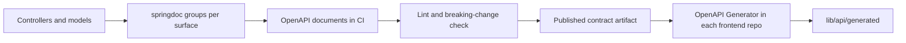

# EVNTGRID — API Design

| | |
|---|---|
| **Builds on** | `API_CONTRACT_STRATEGY.md` |
| **Tools (confirmed)** | REST, springdoc-openapi, OpenAPI Generator |
| **Status** | For owner review. Endpoints are provisional, and items under unresolved rules may change. |

## 1. Surfaces

| Surface | Base path | Application | Authentication | CSRF |
|---|---|---|---|---|
| Public | `/api/public/v1` | customer-web | None | Read only |
| Customer | `/api/customer/v1` | customer-web | Customer session | Required on writes |
| Provider | `/api/provider/v1` | provider-portal | Provider session | Required on writes |
| Admin | `/api/admin/v1` | admin-portal | Administrator session with MFA | Required on writes |
| Webhook | `/webhooks/razorpay` | Razorpay | Signature | Not applicable |

The surface is part of the path, so each maps to one Spring Security filter chain and one OpenAPI document.

## 2. Naming conventions

| Element | Convention | Example |
|---|---|---|
| Collections | Plural kebab-case nouns | `/event-plans` |
| Item | Collection plus opaque ID | `/event-plans/{planId}` |
| Sub-resource | Maximum two levels | `/enquiries/{enquiryId}/quotations` |
| Business action | Noun sub-resource, POST | `/quotations/{quotationId}/acceptance` |
| Query parameters | camelCase | `?eventDate=2027-02-14&venueId=...` |
| JSON properties | camelCase | `eventDate` |
| Enum values | UPPER_SNAKE_CASE | `VEG_AND_NON_VEG` |
| OpenAPI `operationId` | verbNoun, unique per surface | `acceptQuotation` |
| OpenAPI tags | Module name | `quotation` |
| Schemas | Purpose and suffix | `EnquiryCreateRequest`, `EnquiryResponse` |

A generic status update endpoint isn't permitted. Each change is a named action, enforced by its owning module.

## 3. Versioning

| Topic | Rule |
|---|---|
| Scheme | Major version in the path, per surface |
| Non-breaking | New optional fields, new endpoints, new enum values (clients must tolerate unknown values) |
| Breaking | Removal or rename, type changes, new required input, changed meaning |
| New major | Old and new run side by side for a defined overlap |
| Deprecation | `deprecated` in OpenAPI, plus `Deprecation` and `Sunset` headers |
| Release order | Backend first, then frontends |

Spring Framework 7's API versioning may implement the scheme, and springdoc v3 supports it.

## 4. Standard behaviours

| Concern | Rule |
|---|---|
| Pagination | `cursor` and `limit`, with a maximum `limit`. Response has `items` and `nextCursor` |
| Admin totals | Offset pagination allowed on admin tables where totals are required |
| Filtering | Declared parameters only |
| Concurrency | `ETag` and `If-Match`; a stale update returns 409 |
| Idempotency | `Idempotency-Key` required for enquiry submission, quotation sending, acceptance, payment start |
| Correlation | `X-Correlation-Id` returned on every response |
| Money | `{ amountMinor, currency }` |
| Date | `YYYY-MM-DD` for event dates; UTC ISO 8601 for instants |
| Allowed actions | `allowedActions` on commercial records (AR-18) |
| Status | `status` code plus `statusLabel` from the backend |
| SR-2 | `serviceAvailability` entries with `status` and `displayText` |
| SR-1 | Listing responses include `appliedFilters` with a source (customer or venue) |

## 5. Errors

Problem Details (RFC 9457) with `type`, `title`, `status`, `detail`, `code`, `correlationId` and optional `fieldErrors`.

| HTTP | Example `code` |
|---|---|
| 400 | `REQUEST_MALFORMED` |
| 401 | `AUTH_REQUIRED` |
| 403 | `FORBIDDEN`, `PROVIDER_NOT_APPROVED`, `CSRF_INVALID` |
| 404 | `NOT_FOUND`, also used for another party's records |
| 409 | `VERSION_CONFLICT`, `QUOTATION_ALREADY_ACCEPTED` |
| 413 | `UPLOAD_TOO_LARGE` |
| 422 | `VALIDATION_FAILED`, `ENQUIRY_VENUE_CONFLICT` |
| 429 | `RATE_LIMITED`, with `Retry-After` |

## 6. Provisional endpoints

### Public

| Method and path | Purpose | Module |
|---|---|---|
| GET `/categories` | The 12 categories | catalog |
| GET `/categories/{slug}` | Sub Types, subcategories, services | catalog |
| GET `/services/{serviceId}` | Service and options | catalog |
| GET `/search` | Search | discovery |
| GET `/venues` | Venue discovery; SR-1 | discovery |
| GET `/venues/{venueId}` | Venue profile with SR-2 availability | catalog |
| GET `/vendors` | Vendor discovery | discovery |
| GET `/vendors/{providerId}` | Vendor profile | catalog, provider |
| GET `/locations` | Launch geography | catalog |
| GET `/content/{key}` | Homepage or help content (U-25) | content |
| POST `/sessions` | Sign in (U-01) | identity |
| GET `/csrf` | CSRF token | identity |

### Customer

| Method and path | Purpose | Module | Open |
|---|---|---|---|
| GET, PATCH `/me` | Own profile | customer | |
| DELETE `/sessions/current` | Sign out | identity | |
| GET, POST `/event-plans` | Plans | enquiry | |
| GET, PATCH `/event-plans/{planId}` | One plan | enquiry | |
| POST, PATCH, DELETE `/event-plans/{planId}/items[/{itemId}]` | Plan items, including SR-3 | enquiry | D-16 |
| GET, POST `/enquiries` | List and submit | enquiry | D-19 |
| GET `/enquiries/{enquiryId}` | One enquiry | enquiry | |
| GET `/enquiries/{enquiryId}/quotations` | Quotations received | quotation | |
| GET `/quotations/{quotationId}` | One quotation | quotation | |
| POST `/quotations/{quotationId}/acceptance` | Accept; creates booking | booking | D-20, D-22 |
| POST `/quotations/{quotationId}/decline` | Decline | quotation | |
| GET `/bookings`, GET `/bookings/{bookingId}` | Bookings | booking | U-08 |
| POST `/bookings/{bookingId}/payments` | Start payment | payment | U-10 |
| GET `/payments/{paymentId}` | Payment status | payment | |
| POST `/payments/{paymentId}/checkout-confirmation` | Verify checkout signature | payment | |
| GET, POST, DELETE `/favourites` | Favourites (**FUTURE / DEFERRED**, CD-22) | customer | |
| POST `/bookings/{bookingId}/reviews` | Review (**FUTURE / DEFERRED**, CD-22) | review | D-28 |
| GET `/notifications`, GET `/notifications/unread-count` | In-app | notification | |
| POST `/notifications/{id}/read` | Mark read | notification | |
| POST `/support-requests` | Contact request or incorrect-listing report (MVP, minimal, ADR-030) | complaint | D-32 |

### Provider

Resource level only. **Details need provider requirements.**

| Resource | Purpose | Module | Open |
|---|---|---|---|
| `/me`, `/provider` | Own account and business | identity, provider | U-02 |
| `/provider/verification`, `/provider/verification/documents` | Submit verification | provider | U-26 |
| `/venues`, `/venues/{id}/service-availability` | Venues and SR-2 statements | catalog | D-14 |
| `/listings`, `/listings/{id}/locations`, `/listings/{id}/publication` | Listings, areas, publication | catalog | U-05 |
| `/enquiries` | Enquiries addressed to this provider | enquiry | U-21 |
| `/enquiries/{id}/quotations`, `/quotations/{id}` | Quotations | quotation | D-20 |
| `/bookings` | Own bookings | booking | U-08 |
| `/payments` | Payment summary | payment | U-10 |
| `/commissions`, `/settlements` | Reserved | commission, settlement | U-22, U-23 |
| `/notifications` | Own items | notification | |
| `/reviews`, `/complaints` | Own items. Reviews are FUTURE / DEFERRED. Complaints are reserved | review, complaint | D-28, U-24 |
| `/uploads` | Presigned upload | provider, catalog | |

### Admin

Resource level only. **Details need admin requirements.**

| Resource | Purpose | Module | Open |
|---|---|---|---|
| `/providers`, `/providers/{id}/verification`, `/providers/{id}/verification/documents/{docId}/access` | Review; time-limited document access | provider | U-26 |
| `/providers/{id}/approval-decisions` | Approve or reject | provider | U-04 |
| `/catalog/*` | Taxonomy | catalog | D-01 |
| `/listings/{id}/publication` | Publication control | catalog | U-05 |
| `/transactions/{correlationId}/timeline` | Monitoring | administration | |
| `/enquiries`, `/quotations`, `/bookings`, `/payments` | Read views | Owning module | |
| `/audit-events` | Audit search | administration | U-03 |
| `/commissions`, `/settlements` | Reserved | commission, settlement | U-22, U-23 |
| `/reviews/{id}/moderation` | Moderation (FUTURE / DEFERRED) | review | D-28 |
| `/support-requests` | Read incoming contact requests and listing reports (MVP, minimal) | complaint | D-32, U-03 |
| `/complaints` | Handling (reserved) | complaint | U-24 |
| `/content` | Content | content | U-25 |
| `/administrators` | Accounts | identity | U-03 |

### Webhook

| Method and path | Rule |
|---|---|
| POST `/webhooks/razorpay` | Raw body retained for signature check; event stored; 2xx returned after storage |

## 7. OpenAPI contract generation

| Stage | Plan |
|---|---|
| Source | springdoc groups for public, customer, provider, admin (v3 for Spring Boot 4) |
| Extraction | An integration test starts the app with Testcontainers and saves each document |
| Version | Output OpenAPI 3.0 for generation (ADR-008). springdoc defaults to 3.1, and the generator's 3.1 support for `typescript-fetch` hasn't been confirmed. A test will decide if 3.1 can be used |
| Validation | OpenAPI Generator `validate`; breaking-change check needs TA-12 |
| Publication | Versioned artifact from CI, plus committed copies per release |
| Generator | OpenAPI Generator, `typescript-fetch` (listed as stable); pinned exact version |
| Mapping | customer-web generates public and customer; provider-portal generates provider; admin-portal generates admin |
| Output | Never hand-edited. Regenerated in CI, and a diff fails the build if not committed |
| TanStack Query | Query and mutation hooks are written by hand over the generated functions |
| Zod | Separate form schemas (ADR-010) |
| Timing | Clients generated once an endpoint is Stable, as defined in `API_CONTRACT_STRATEGY.md` |

**Annotation standards.** Each operation has an `operationId`, a summary, the error responses it can return, and a security requirement. Internal endpoints aren't included, and Swagger UI is disabled in production.

## Sources

- [springdoc: OpenAPI 3.1 default discussion](https://github.com/springdoc/springdoc-openapi/issues/2790)
- [OpenAPI Generator: typescript-fetch](https://openapi-generator.tech/docs/generators/typescript-fetch)
- [springdoc-openapi](https://github.com/springdoc/springdoc-openapi)
