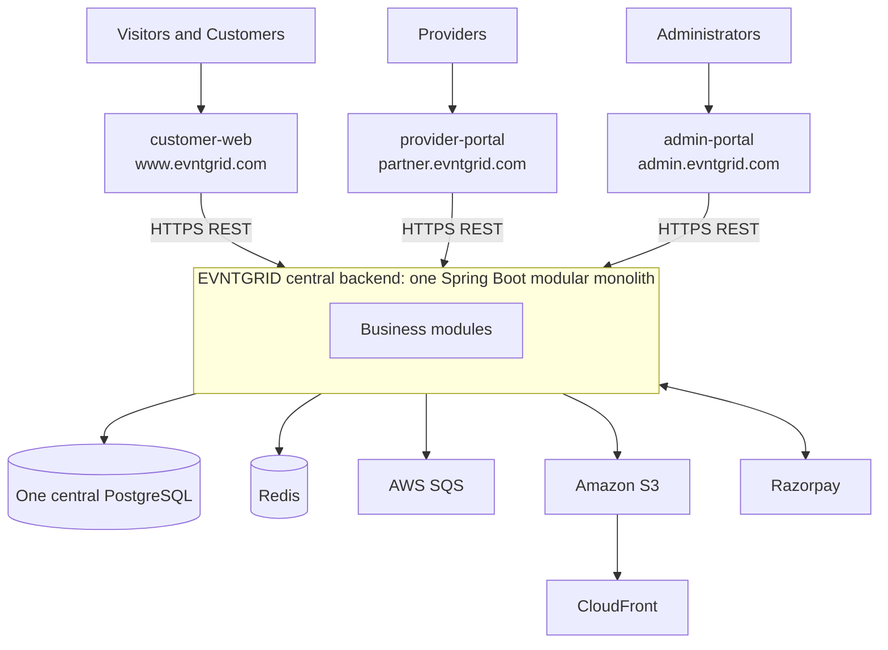
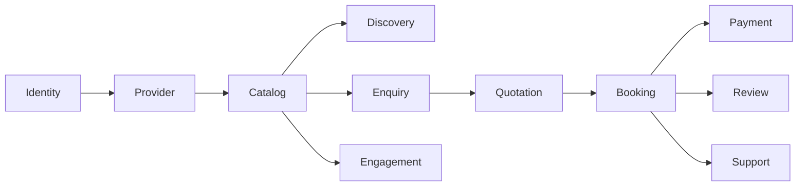

# EVNTGRID — Application Ecosystem

| | |
|---|---|
| **Scope** | Three frontend applications, one modular monolith backend, one PostgreSQL database |
| **Status** | Architecture baseline for owner review |
| **Companions** | `CROSS_APPLICATION_SYNCHRONIZATION.md`, `CENTRAL_IDENTITY_AND_SECURITY.md`, `API_CONTRACT_STRATEGY.md`, `DATA_OWNERSHIP.md`, `DEPLOYMENT_ARCHITECTURE.md` |
| **Earlier work** | `D-xx` references point to `CUSTOMER_REQUIREMENTS_GAPS.md` |

## 1. How decisions are labelled

| Label | Meaning | ID | May the team build on it? |
|---|---|---|---|
| **CONFIRMED** | Specified by the owner | `CD-xx` | Yes |
| **RECOMMENDED** | Architect's proposal awaiting approval | `AR-xx` | After approval |
| **UNRESOLVED** | Not decided; depends on the owner or on later engineering work | `U-xx` | No. Keep the design open. |

The full register is in section 8. All six documents use these IDs.

## 2. System overview

No frontend has a path to PostgreSQL, Redis, SQS or a Razorpay secret. Every business operation enters through the backend.

## 3. The three applications

| | customer-web | provider-portal | admin-portal |
|---|---|---|---|
| **Proposed address** | www.evntgrid.com | partner.evntgrid.com | admin.evntgrid.com |
| **Users** | Visitor, Customer | Provider (INDIVIDUAL or COMPANY) | Administrator |
| **Purpose** | Public marketplace, discovery and customer bookings | Providers manage their marketplace business | Internal marketplace administration and operations |
| **Main areas** | Discovery, profiles, enquiries, quotations, bookings, payments, account | Onboarding, listings, enquiries, quotations, bookings, payment status | Provider approval, publication control, catalogue, transaction monitoring, audit |
| **Indexed by search engines** | Yes, for public pages | Marketing pages only, if any | Never |
| **Rendering emphasis (recommended)** | Server-rendered public pages for search visibility | Mostly authenticated, interactive screens | Authenticated, data-heavy screens |
| **API surface (AR-03)** | public, customer | provider | admin |

### What each frontend may and may not contain

| A frontend MAY | A frontend MUST NOT |
|---|---|
| Own its layout, navigation, design and user experience (CD-07) | Connect to PostgreSQL, Redis or SQS, or hold their credentials (CD-04) |
| Validate input to help the user (format, required fields) | Be the only place a business rule is enforced (CD-08) |
| Show or hide actions based on what the backend says is allowed (AR-18) | Decide whether a provider is approved, a service is published or a quotation can be accepted |
| Hold short-lived display state | Keep its own copy of customer, provider or booking records (CD-05) |
| Use a generated TypeScript client (CD-09) | Hold any secret value (CD-10) |

### What is shared between the frontends

| Shared | Not shared |
|---|---|
| Backend APIs and their OpenAPI contracts | Layouts, navigation, page code |
| Brand assets, if the owner wants consistent branding | Session cookies (AR-02) |
| Central user identity (CD-06) | Deployment pipelines |

A shared UI component library is deliberately not proposed, because it would couple the three experiences that CD-07 keeps independent.

## 4. Central backend

One codebase, built with Maven, produces one deployable artifact. Spring Modulith enforces the module boundaries inside it. Running the artifact in separate web and worker roles (AR-08) is still one application and does not introduce microservices.

### 4.1 Modules

The first eight are in the owner's architecture diagram. The others are recommendations to cover requirements that have no module in the diagram (D-35, AR-04).

| Module | Status | Owns | Source rule or requirement |
|---|---|---|---|
| Identity | CONFIRMED | User accounts, credentials, role grants, sessions | CD-06 |
| Catalog | CONFIRMED | Taxonomy, venue and service listings, publication state, venue service permissions | SR-2, SR-3, CD-11 |
| Discovery | CONFIRMED | Search, filters, listing read models | SR-1 |
| Enquiry | CONFIRMED | Event plans, enquiries | Synchronization example |
| Quotation | CONFIRMED | Quotations, acceptance state | Synchronization example |
| Booking | CONFIRMED | Bookings, availability | Synchronization example |
| Payment | CONFIRMED | Razorpay orders, payments, webhooks | Synchronization example |
| Administration | CONFIRMED | Operational workflows, transaction monitoring views | CD-11, CD-13 |
| Provider | RECOMMENDED | Provider organisation, type, approval status, members | CD-11, CD-18 |
| Notification | RECOMMENDED | Templates, delivery, in-app notifications, preferences | CD-14 |
| Audit | RECOMMENDED | Append-only audit records | CD-13 |
| Review | FUTURE / DEFERRED (owner decision, CD-22) | Ratings and reviews | D-28 |
| Engagement | FUTURE / DEFERRED (owner decision, CD-22); would sit in `customer` | Favourites | D-35 |
| Support | RECOMMENDED | Customer and provider support cases | D-32 |

### 4.2 Dependency direction (recommended)

Dependencies point one way, and Spring Modulith's structure verification fails the build on a cycle.

Each arrow reads "is used by". Notification and Audit consume events and calls from every module. Administration sits at the top and calls other modules through their public APIs.

### 4.3 Module rules (recommended)

1. A module's internal classes and repositories are private to it.
2. One module calls another only through its published interface, or reacts to its events.
3. No JPA relationship crosses a module boundary. Records in other modules are referenced by ID.
4. Every table has exactly one owning module (see `DATA_OWNERSHIP.md`).
5. REST controllers contain no business logic. They call their module's application service.

## 5. Why this shape fits a marketplace

| Concern | How the design handles it |
|---|---|
| Three audiences with different needs | Independent frontends and API surfaces |
| One truth about a booking | One record in one database, read by all three applications |
| Complex rules across enquiry, quotation and booking | Normal database transactions inside one application |
| Scale | The web and worker roles scale separately; heavy work moves to SQS |
| Avoiding premature distribution | Clear module boundaries without the network and consistency cost of microservices |

## 6. Technology versions at the time of writing

Versions are checked at the start of the build (U-20). These facts confirm the chosen stack is compatible today.

| Component | Finding |
|---|---|
| Java 25 with Spring Boot | Spring Boot 4.0 has first-class Java 25 support; 4.1 has since been released |
| Spring Modulith | The 2.x line is built on Spring Boot 4 |
| Next.js | Version 16 renamed `middleware` to `proxy`. It is not an authorization layer |
| springdoc-openapi | Spring Boot 4 requires springdoc-openapi v3 |
| Spring Security | Spring Security 7 includes multi-factor authentication support |

## 7. Requirement traceability

| # | Requirement | Decision | Where addressed |
|---|---|---|---|
| 1 | Three separately developed and deployable Next.js apps | CD-01 | This document, `DEPLOYMENT_ARCHITECTURE.md` |
| 2 | One Spring Boot modular monolith | CD-02 | Section 4 |
| 3 | One central PostgreSQL | CD-03 | `DATA_OWNERSHIP.md` |
| 4 | All business operations through backend | CD-04 | Section 3, `API_CONTRACT_STRATEGY.md` |
| 5 | Frontends never access PostgreSQL | CD-04 | Section 3, `DEPLOYMENT_ARCHITECTURE.md` |
| 6 | No duplicate customer, provider or booking data | CD-05 | `DATA_OWNERSHIP.md` |
| 7 | Consistent central identity and authorization | CD-06 | `CENTRAL_IDENTITY_AND_SECURITY.md` |
| 8 | Permissions and ownership enforced on backend | CD-06 | `CENTRAL_IDENTITY_AND_SECURITY.md` |
| 9 | Independent frontend experience | CD-07 | Section 3 |
| 10 | Business rules in backend modules | CD-08 | Sections 3–4, `API_CONTRACT_STRATEGY.md` |
| 11 | Documented REST contracts | CD-09 | `API_CONTRACT_STRATEGY.md` |
| 12 | TypeScript clients from OpenAPI | CD-09 | `API_CONTRACT_STRATEGY.md` |
| 13 | Secure authentication across three apps | CD-10 | `CENTRAL_IDENTITY_AND_SECURITY.md` |
| 14 | CORS, CSRF, sessions, secure API communication | CD-10 | `CENTRAL_IDENTITY_AND_SECURITY.md` |
| 15 | No secrets in frontend code | CD-10 | `CENTRAL_IDENTITY_AND_SECURITY.md` |
| 16 | Backend-controlled approval and publication | CD-11 | `CENTRAL_IDENTITY_AND_SECURITY.md`, `DATA_OWNERSHIP.md` |
| 17 | Consistent updates across applications | CD-12 | `CROSS_APPLICATION_SYNCHRONIZATION.md` |
| 18 | Audit logs | CD-13 | `CENTRAL_IDENTITY_AND_SECURITY.md`, `DATA_OWNERSHIP.md` |
| 19 | Notifications and background processing | CD-14 | `CROSS_APPLICATION_SYNCHRONIZATION.md`, `DEPLOYMENT_ARCHITECTURE.md` |
| 20 | Modular monolith, no microservices | CD-02 | Section 4 |

## 8. Decision register

### Confirmed

| ID | Decision |
|---|---|
| CD-01 | Three separately developed and deployable Next.js applications: customer-web, provider-portal, admin-portal |
| CD-02 | One central Spring Boot modular monolith; no microservices |
| CD-03 | One central PostgreSQL database |
| CD-04 | All business operations go through the backend; frontends never access PostgreSQL |
| CD-05 | No duplicate copies of customer, provider or booking data |
| CD-06 | Central identity and authorization; permissions and record ownership enforced on the backend |
| CD-07 | Each frontend's layout, navigation and user experience are independent |
| CD-08 | Business rules live in backend modules |
| CD-09 | Documented REST contracts; TypeScript clients generated from OpenAPI when the API is ready |
| CD-10 | Secure authentication; CORS, CSRF, session and cookie handling planned; no secrets in frontend code |
| CD-11 | Provider approval and service publication are controlled by backend rules |
| CD-12 | Enquiry, quotation, booking and payment updates are consistent across applications |
| CD-13 | Important administrative and business changes are audit logged |
| CD-14 | Notifications and background processing are planned |
| CD-15 | Backend stack: Java 25, Spring Boot, Spring Modulith, Maven, Spring Security, Spring Data JPA, REST, PostgreSQL, Flyway |
| CD-16 | Supporting technologies: Redis, AWS SQS, Amazon S3, CloudFront, Razorpay |
| CD-17 | Roles: Visitor, Customer, Provider, Administrator |
| CD-18 | Provider types INDIVIDUAL and COMPANY; approval statuses PENDING, APPROVED, REJECTED; provider type is not a user role |
| CD-19 | Transaction sequence as given in the synchronization example |
| CD-20 | Application names and proposed addresses (addresses remain "proposed"; see U-18) |
| CD-21 | **Owner decision (2026-11-09):** one Git repository (monorepo) rooted at the project folder (location chosen by the owner; on the Desktop: `C:\Users\<you>\OneDrive\Desktop\EventGrid\EventGrid`) holds the backend, all three frontends, infrastructure, documentation and scripts. One root `.git` and one root `.gitignore`; no nested repositories. Applications still build and release independently (CD-01) |
| CD-22 | **Owner decision (2026-11-09):** favourites and reviews are deferred beyond the MVP. They are FUTURE / DEFERRED, not MVP modules or deliverables. Their requirements stay in the documentation |
| CD-23 | **Owner decision (2026-11-09):** the frontend `stores/` folder stays empty. No client-state library (Zustand, Redux or similar) is approved. TanStack Query holds server state (CD-05) and React's built-in state holds local UI state |

### Recommended, awaiting approval

| ID | Recommendation | Main document |
|---|---|---|
| AR-01 | Each application calls the backend on its own hostname, through path routing, so browsers make no cross-origin API calls | `CENTRAL_IDENTITY_AND_SECURITY.md` |
| AR-02 | Opaque server-side sessions in Redis, with a separate session cookie per application | `CENTRAL_IDENTITY_AND_SECURITY.md` |
| AR-03 | Separate API surfaces: public, customer, provider, admin | `API_CONTRACT_STRATEGY.md` |
| AR-04 | Add Provider, Notification, Audit, Review, Engagement and Support modules | This document |
| AR-05 | One PostgreSQL schema per module inside the one database | `DATA_OWNERSHIP.md` |
| AR-06 | Quotation acceptance and booking creation occur in one database transaction | `CROSS_APPLICATION_SYNCHRONIZATION.md` |
| AR-07 | Spring Modulith's event publication registry as the outbox; SQS for delivery and slow work | `CROSS_APPLICATION_SYNCHRONIZATION.md` |
| AR-08 | One artifact, run in web and worker roles | `DEPLOYMENT_ARCHITECTURE.md` |
| AR-09 | Frontends refresh by refetching first; add server-sent events only when needed | `CROSS_APPLICATION_SYNCHRONIZATION.md` |
| AR-10 | AWS Mumbai region, ECS Fargate for all workloads, RDS Multi-AZ, ElastiCache | `DEPLOYMENT_ARCHITECTURE.md` |
| AR-11 | OpenAPI generated from the backend, committed, and checked for breaking changes | `API_CONTRACT_STRATEGY.md` |
| AR-12 | Mandatory MFA and network restriction for Administrators | `CENTRAL_IDENTITY_AND_SECURITY.md` |
| AR-13 | Verified Razorpay webhooks are the authority for payment status | `CROSS_APPLICATION_SYNCHRONIZATION.md` |
| AR-14 | PostgreSQL full-text and trigram search at launch; no separate search engine | `DATA_OWNERSHIP.md` |
| AR-15 | **Superseded by CD-21.** The recommendation was separate repositories for the backend and each frontend. The owner chose one repository | `DEPLOYMENT_ARCHITECTURE.md` |
| AR-16 | Flyway runs as one deployment step, using expand-and-contract changes | `DEPLOYMENT_ARCHITECTURE.md` |
| AR-17 | Audit records are written in the same transaction as the change | `CENTRAL_IDENTITY_AND_SECURITY.md` |
| AR-18 | API responses state which actions are currently allowed | `API_CONTRACT_STRATEGY.md` |
| AR-19 | Point-in-time commercial snapshots are the only permitted repetition of business data | `DATA_OWNERSHIP.md` |
| AR-20 | Next.js servers only render and forward; they hold no business logic | `CENTRAL_IDENTITY_AND_SECURITY.md` |

### Unresolved

| ID | Item | Linked decision |
|---|---|---|
| U-01 | Customer sign-in method; whether enquiries need an account | D-29 |
| U-02 | Provider sign-in method; multiple staff users for a COMPANY | New |
| U-03 | Whether Administrators have sub-permissions such as finance or support | New |
| U-04 | Provider lifecycle beyond the three statuses: suspension, re-application after REJECTED | New |
| U-05 | Service publication states; whether each listing or edit needs review | New |
| U-06 | How venue owners and event management companies fit the provider model | D-05 |
| U-07 | Multi-vendor booking structure | D-21 |
| U-08 | Booking statuses, confirmation and what makes a booking binding | D-22 |
| U-09 | Availability model and double-booking handling | D-23 |
| U-10 | Payment policy, money flow, which Razorpay products are used, refunds, commission | D-24, D-25, D-26 |
| U-11 | Build order and how the marketplace operates before provider-portal is live | D-18 |
| U-12 | Whether one person's login can be both Customer and Provider | New |
| U-13 | Email, SMS and WhatsApp delivery vendors | D-31 |
| U-14 | TypeScript client generator | New |
| U-15 | Capacity, service levels, recovery targets | New |
| U-16 | Data retention, deletion and compliance | D-34 |
| U-17 | AWS account structure and final hosting confirmation | New |
| U-18 | Ownership of evntgrid.com and DNS control | New |
| U-19 | Direct booking of fixed-price services | D-17 |
| U-20 | Exact version pins at build start | New |
| U-21 | Enquiry routing and when contact details are shared | D-19 |

## 9. Effect on earlier requirement decisions

| Decision | Effect of this brief |
|---|---|
| D-17 Buying model | Enquiry, quotation and booking are now confirmed as the main flow (CD-19). Direct booking remains open (U-19). |
| D-18 Operating before provider portal | The portal's design is now specified. Its build order relative to customer-web is still open (U-11). |
| D-24 Payments | Razorpay is the chosen gateway (CD-16). Whether, when and how money is collected remains open (U-10). |
| D-33 Platforms | The confirmed design covers three web applications. Native mobile apps are out of this design. |
| D-35 Backend coverage | Answered by the AR-04 recommendation, once approved. |

## Sources

- [Spring Boot 4.0.0 announcement](https://hn.jakechampion.name/reader/https://spring.io/blog/2025/11/20/spring-boot-4-0-0-available-now)
- [Spring news roundup, June 2026: Spring Boot 4.1 and Spring Modulith 2.1](https://infoq.com/news/2026/06/spring-news-roundup-jun08-2026)
- [InfoQ: Spring 7 and Spring Boot 4](https://www.infoq.com/news/2025/11/spring-7-spring-boot-4)
- [OWASP Next.js Security Cheat Sheet](https://cheatsheetseries.owasp.org/cheatsheets/Nextjs_Security_Cheat_Sheet.html)
- [springdoc-openapi](https://github.com/springdoc/springdoc-openapi)
