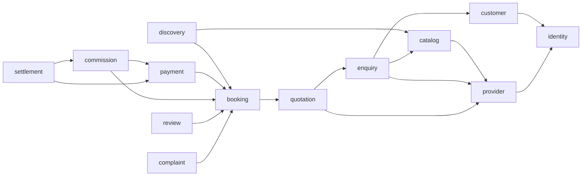

# EVNTGRID — Backend Architecture

| | |
|---|---|
| **Stack (confirmed)** | Java 25, Spring Boot, Spring Modulith, Maven, Spring Data JPA, PostgreSQL, Flyway, Spring Security, springdoc-openapi |
| **Shape** | One modular monolith, one artifact, web and worker roles, 17 owner-specified modules |
| **Status** | For owner review. No application code. |

## 1. Project structure

```text
backend/              (in the one repository, CD-21; generated by Spring Initializr)
  pom.xml
  src/main/java/com/evntgrid/
    Application
    shared/
    identity/
    customer/
    provider/
    catalog/
    discovery/
    enquiry/
    quotation/
    booking/
    payment/
    commission/
    settlement/
    review/
    notification/
    complaint/
    content/
    administration/
  src/main/resources/db/migration/<module>/
  src/test/
```

Each direct sub-package is one Spring Modulith application module. Maven builds a single artifact, and multi-module Maven is not needed.

Module folders are **not created in advance**. The folder script creates only an empty `backend/` folder; Spring Initializr fills it, and a module's packages are added when its first class is written. The module list and statuses are repeated in `BACKEND_SETUP.md`.

## 2. Inside a module

The owner's package structure (`api`, `application`, `domain`, `infrastructure`) replaces the earlier six-package design (`web`, `application`, `domain`, `persistence`, `integration`, `events`).

| Package | Contents | Visible to other modules? |
|---|---|---|
| module root | Public service interfaces, public data records, and the domain events the module publishes | Yes |
| `api` | REST controllers per API surface, request and response models | No, unless a package is exposed with `@NamedInterface` (decide when the first cross-module call is written) |
| `application` | Use cases, transactions, authorization calls | No |
| `domain` | Entities, value objects, state rules | No |
| `infrastructure` | Spring Data JPA repositories and external adapters | No |

**Rules**

1. Controllers call only their module's application layer.
2. JPA entities never leave the module, and never appear in an API.
3. No JPA relationship crosses a module. Other modules are referenced by ID.
4. Repositories for provider-owned data require a `providerId` argument (see `SECURITY_ARCHITECTURE.md`, section 3).
5. Each use case has one transaction boundary, in the application layer.
6. Status changes are domain methods, and setters for status do not exist.

## 3. Module dependencies

Arrows mean "depends on". `shared` is available to all and isn't drawn. Spring Modulith's verification test fails the build on any undeclared dependency or cycle.



| Rule | Reason |
|---|---|
| `notification` may read event types from any module; no module depends on it | Prevents cycles |
| `administration` may call any module's public interface; no module depends on it | It sits at the top |
| `content` depends only on `shared` | Independent |
| Lower modules never call higher ones | `booking` never calls `payment` |
| Screens needing both booking and payment use a thin query layer above them | Keeps dependencies one-way |
| `review` and `payment` stay in the diagram above | `review` is FUTURE / DEFERRED and `payment` is not in the MVP. They stay so the future dependency direction is not lost |

## 4. Module responsibilities

Status: **ACTIVE** means designed for build, subject to the listed decisions. **BOUNDARY** means responsibility is reserved and the design waits for business rules. **NOT IN MVP** means the design is kept but nothing is built in the first release. **FUTURE / DEFERRED** means the owner has deferred it beyond the MVP (CD-22); it is not an MVP module.

| Module | Status | Responsible for | Not responsible for | Publishes | Open |
|---|---|---|---|---|---|
| `shared` | ACTIVE | IDs, Money, correlation context, error model, audit recording (ADR-004), idempotency, sender interface | Any business rule | — | ADR-004 |
| `identity` | ACTIVE | User accounts, credentials, role grants, sessions, sign-in, MFA | Customer or provider business data | `UserRegistered`, `RoleGranted` | U-01, U-02, U-12 |
| `customer` | ACTIVE | Customer profile, preferences. Favourites are FUTURE / DEFERRED (CD-22) | Enquiries and bookings | `CustomerRegistered` | D-29 |
| `provider` | ACTIVE | Provider organisation, type, membership, verification, approval | Listings | `ProviderApproved`, `ProviderRejected` | U-02, U-04, U-06, U-26 |
| `catalog` | ACTIVE | Taxonomy, venues, listings, venue service availability (SR-2), service locations, publication | Search ranking | `ListingPublished`, `ListingUnpublished`, `VenueServicePermissionChanged` | D-01, D-07, D-12, D-14, U-05 |
| `discovery` | ACTIVE | Search, filters, automatic venue filters (SR-1), derived read models | Writing listings | — | D-13 |
| `enquiry` | ACTIVE | Event plans, requirements, food choice (SR-3), enquiries, recipients | Pricing | `EnquirySubmitted` | D-16, U-21, U-29 |
| `quotation` | ACTIVE | Quotations, lines, validity, acceptance state | Creating bookings | `QuotationSent`, `QuotationAccepted`, `QuotationDeclined` | D-20, U-29 |
| `booking` | ACTIVE | Bookings, agreed snapshots, availability when defined; orchestrates acceptance | Payment status | `BookingCreated`, `BookingStatusChanged` | U-07, U-08, U-09 |
| `payment` | NOT IN MVP (design kept); business flow blocked (D-24, U-10) | Razorpay orders, payments, webhooks, reconciliation | Commission, settlement policy | `PaymentStatusChanged` | U-10 |
| `commission` | BOUNDARY | Calculating platform charges when rules exist | Moving money | — | U-22 |
| `settlement` | BOUNDARY | Paying providers when a fund flow exists | Calculating commission | — | U-23 |
| `review` | FUTURE / DEFERRED (CD-22) | Ratings, reviews, moderation state | Provider profile data | `ReviewPublished` (future) | D-28 |
| `notification` | ACTIVE | In-app notifications, delivery, preferences, templates | Deciding when business events occur | — | D-31, TA-10 |
| `complaint` | MVP, minimal (ADR-030); all other complaint handling BOUNDARY | MVP: intake of support contacts and incorrect-listing reports (D-32). Later: complaint handling (U-24) | Refund decisions | — | U-24 |
| `content` | BOUNDARY | Homepage and help content | Catalogue taxonomy | — | U-25 |
| `administration` | ACTIVE (MVP need depends on D-18) | Operator workflows, transaction timeline, audit view | Owning other modules' rules | — | U-03 |

## 5. Provider and admin boundaries

These define **what the backend separates**, not product behaviour. Detailed provider and admin requirements need their own step.

| Boundary | Rule |
|---|---|
| Provider surface | `/api/provider/v1`, controllers in each owning module's `api` package |
| Admin surface | `/api/admin/v1`, likewise in owning modules, plus `administration` for cross-module views |
| Approval decision | Decided through `provider`'s rules. `administration` only orchestrates operator workflow |
| Publication | Decided through `catalog`'s rules, which consult `provider` for approval status |
| Admin override | Goes through the owning module's rules, never a direct table change, and is audited |
| Provider commercial data | Reached only through the provider's own session or the admin surface |

## 6. Core flows

| Flow | Module path | Transaction |
|---|---|---|
| Submit enquiry | enquiry → catalog (published, SR-2), provider (approved) | One |
| Send quotation | quotation → enquiry (recipient), provider (approved) | One |
| Accept quotation | booking orchestrates quotation and booking | One (ADR-019) |
| Provider approval | administration → provider | One |
| Publish listing | catalog → provider | One |
| Webhook | payment | Store and acknowledge, then process |

Full sequences are in `CROSS_APPLICATION_SYNCHRONIZATION.md`.

## 7. Persistence

| Topic | Rule |
|---|---|
| Hibernate | Through Spring Data JPA. Open-session-in-view is disabled |
| Fetching | Lazy by default. Fetch plans are explicit for list screens |
| Concurrency | `@Version`-style optimistic locking on mutable aggregates |
| Migrations | Flyway files by module, one history, run as a deployment task |
| Schema validation | Hibernate validates only; it never creates schema |
| Connection pool | Sized from RDS limits, and load-tested |
| Virtual threads | Available on Java 25, and enabled after load testing; they don't remove the connection limit |

## 8. Events and async work

| Topic | Rule |
|---|---|
| Publication | Spring Modulith event registry in the same transaction (ADR-020) |
| Listeners | After-commit in a new transaction; idempotent |
| Externalization | Selected events to SQS (TA-02) |
| Resubmission | Worker only, under a lock; automatic republish on restart stays off |
| Payloads | IDs and minimal data, never secrets or OTPs |

## 9. Cross-cutting

| Concern | Approach |
|---|---|
| API documentation | springdoc grouped per surface |
| Errors | Problem Details with stable codes |
| Validation | Bean Validation at the controller; business rules in the domain |
| Observability | Spring Boot OpenTelemetry starter, Micrometer, Actuator on a private port |
| Configuration | Per environment through ECS; secrets via TA-05 |
| Roles | One image, with web or worker chosen by Spring profile |

## 10. Backend testing

| Target | Tool | Example |
|---|---|---|
| Domain state rules | JUnit 5 | A status cannot skip a required step |
| Module boundaries | Spring Modulith verification | No cycles |
| Module behaviour | Module tests with Testcontainers | Quotation with real PostgreSQL |
| Security | JUnit 5 with Spring Security test support | Provider A cannot read Provider B's enquiry |
| Events | Spring Modulith scenario tests | `QuotationSent` results in a notification |
| Migrations | Testcontainers PostgreSQL | Fresh and upgrade runs |
