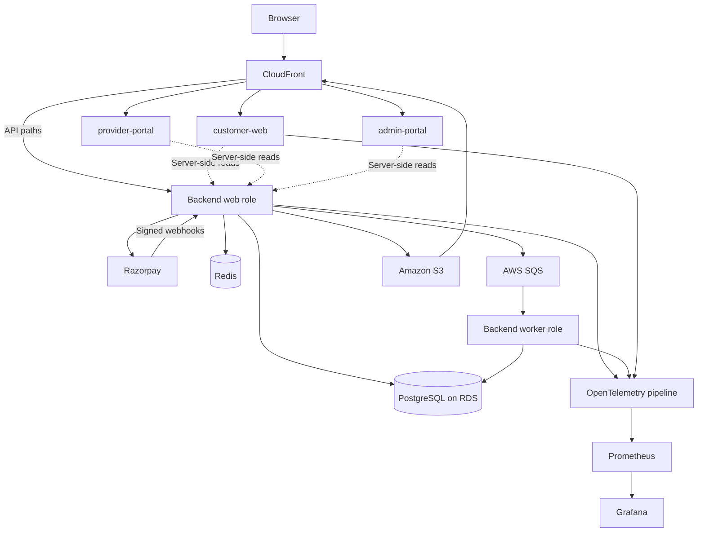

# EVNTGRID — System Architecture

| | |
|---|---|
| **Scope** | Whole-system plan: applications, backend, storage, notifications, payments, monitoring, background work, testing and deployment |
| **Status** | For owner review. No application code or SQL migrations. |
| **Decisions** | `ARCHITECTURE_DECISIONS.md` holds ADR, TA and U references. `TA-xx` items need approval before use. |

## 1. Planning index

| # | Plan item | Document |
|---|---|---|
| 1 | Full application architecture | This document |
| 2 | Frontend architecture for all three applications | `FRONTEND_ARCHITECTURE.md` |
| 3 | Customer feature architecture | `FRONTEND_ARCHITECTURE.md`, section 8 |
| 4 | Provider and admin module boundaries | `BACKEND_ARCHITECTURE.md`, section 5; `FRONTEND_ARCHITECTURE.md`, sections 9–10 |
| 5 | Backend module responsibilities | `BACKEND_ARCHITECTURE.md` |
| 6 | API naming and versioning | `API_DESIGN.md` |
| 7 | OpenAPI contract generation | `API_DESIGN.md`, section 7 |
| 8 | Central authentication and authorization | `SECURITY_ARCHITECTURE.md` |
| 9 | Database architecture | `DATABASE_SCHEMA.md`, `ENTITY_RELATIONSHIPS.md` |
| 10 | File storage | This document, section 5 |
| 11 | Notifications | This document, section 6 |
| 12 | Payment integration | This document, section 7 |
| 13 | Logging and monitoring | This document, section 8 |
| 14 | Background processing | This document, section 9 |
| 15 | Testing and deployment | This document, sections 10–11 |

## 2. Technology stack

| Layer | Confirmed | Version note (ADR-026, U-20) |
|---|---|---|
| Frontend | Next.js, TypeScript, Tailwind CSS, shadcn/ui, TanStack Query, React Hook Form, Zod | Next.js 16 line |
| Backend | Java 25, Spring Boot, Spring Modulith, Maven, Spring Data JPA, Flyway, Spring Security, springdoc-openapi, OpenAPI Generator | Spring Boot 4.1.x; Spring Modulith 2.x; springdoc v3 |
| Database | PostgreSQL on AWS RDS | PostgreSQL 18 is available on RDS |
| Infrastructure | Docker, Redis, AWS SQS, Amazon S3, CloudFront, AWS ECS Fargate, AWS RDS | |
| Payments | Razorpay | |
| Testing | JUnit 5, Testcontainers, Vitest, Playwright, k6 | |
| Monitoring | OpenTelemetry, Prometheus, Grafana | Hosting needs TA-07 to TA-09 |

Running this stack on AWS also depends on foundation services that aren't in the list above: networking, load balancing, image registry and certificates (TA-03), managed Redis (TA-04), secrets and keys (TA-05) and WAF (TA-06).

## 3. System overview

## 4. Request lifecycle

| Stage | What happens | Where |
|---|---|---|
| 1 | Browser request reaches CloudFront; WAF rules apply (TA-06) | Edge |
| 2 | API paths go to the backend, other paths to that host's Next.js app | CloudFront |
| 3 | Session resolved from the app's own cookie; surface checked | Spring Security |
| 4 | CSRF, origin and rate-limit checks | Spring Security, Redis |
| 5 | Request shape validated against the contract | Controller |
| 6 | Role, status and ownership checks | Application service |
| 7 | Business rule applied and state changed | Owning module |
| 8 | Audit record and event publication saved in the same transaction | PostgreSQL |
| 9 | Response returned, with `allowedActions` | Controller |
| 10 | After commit, listeners and SQS work proceed | Modulith, worker |

## 5. File storage

| Bucket (illustrative) | Contents | Access | Delivery |
|---|---|---|---|
| `evntgrid-public-media` | Listing and venue images, approved content images | Private bucket, CloudFront origin access only | CloudFront at `media.evntgrid.com` |
| `evntgrid-private-documents` | Provider verification documents | Backend role only | Short-lived presigned download after authorization and audit |
| `evntgrid-uploads-quarantine` | New uploads awaiting checks | Upload through presigned URL only | None |

**Upload flow**

1. The frontend asks the backend for permission, stating purpose, file type and size.
2. The backend checks ownership and limits, and returns a presigned upload to quarantine.
3. The browser uploads directly to S3, so large files never pass through the backend.
4. The frontend tells the backend that the upload finished.
5. The backend verifies object size, type and checksum.
6. Verification documents are malware-scanned (TA-11). GuardDuty scans after upload, so access must stay denied until a clean result arrives.
7. The file moves to its final bucket, and metadata is saved in PostgreSQL.

**Rules.** Block Public Access is on for all buckets. Bucket policies require TLS. Object keys use random IDs and never customer-provided names. Public images are referenced by key, and URLs are built by the backend. Image resizing isn't in the stack, so it is deferred and would need its own approval.

Details of document security are in `SECURITY_ARCHITECTURE.md`, section 5.

## 6. Notifications

| Concern | Design | Status |
|---|---|---|
| Trigger | Domain events from each module | ADR-020 |
| Owner | `notification` module, which no other module depends on | Proposed |
| In-app | Stored in PostgreSQL; read through each surface's API; unread count refreshed by polling | Can ship without vendors |
| Email, SMS, WhatsApp | Queued to SQS, sent by the worker through a vendor adapter | Blocked on TA-10, D-31 |
| Idempotency | One notification per recipient, source event and type | Database constraint |
| Preferences and consent | `notification` module | D-31, D-34 |
| Templates | Versioned; content is approved separately | Proposed |
| OTP delivery | Through a narrow sender interface in `shared`, so that `identity` doesn't depend on `notification`, and codes are never stored in events | Depends on U-01 |

## 7. Payment integration

Razorpay is confirmed. **Whether, when, how much and to whom a customer pays are undefined (U-10).** The flow below describes the mechanics only and would be enabled once D-24 is decided.

| Stage | Behaviour |
|---|---|
| Start | Customer starts payment. `payment` validates ownership and that payment is permitted, then creates a Razorpay order. |
| Checkout | customer-web opens Razorpay Standard Checkout with the public key ID. |
| Callback | Backend verifies the checkout signature and shows the payment as processing. |
| Webhook | `hooks.evntgrid.com` receives the event. The signature is verified on the raw body. |
| Deduplication | `x-razorpay-event-id` is saved under a unique key, then 2xx is returned. |
| State change | `payment` advances its status. Out-of-order events cannot move it backward. |
| Reconciliation | A worker job checks unresolved payments with Razorpay. |

**Boundaries.** Card data never enters EVNTGRID. `booking` holds no payment status. `commission` and `settlement` stay as module boundaries until U-22 and U-23 are answered. Razorpay Route could split funds through Linked Accounts, but it is not assumed, and the fund flow needs legal and Razorpay review (see `ARCHITECTURE_DECISIONS.md`, section 6).

## 8. Logging and monitoring

Spring Boot 4 provides `spring-boot-starter-opentelemetry`, with OTLP export of metrics and traces. Log export needs additional setup. Actuator can expose metrics in Prometheus format.

| Signal | Source | Pipeline | Store | View |
|---|---|---|---|---|
| Metrics | Micrometer, Next.js OpenTelemetry | OpenTelemetry Collector | Prometheus (hosting TA-09) | Grafana |
| Traces | Micrometer Tracing, OpenTelemetry | OpenTelemetry Collector | TA-08 | Grafana |
| Logs | Structured JSON | Container log driver | TA-07 | Grafana or log console |

The Collector runs as a container beside each ECS task.

**Log rules.** Include correlation ID, trace ID, surface and module. Never log tokens, session IDs, OTPs, document contents, or unmasked phone, email and payment details. Audit records are separate from logs and live in PostgreSQL.

**Metric rules.** Labels must be low-cardinality, so no user, booking or provider IDs.

| Grafana dashboard | Main signals |
|---|---|
| Service health | Request rate, errors, latency per surface |
| JVM and database | Heap, threads, connection pool, slow queries |
| Async work | Queue depth, DLQ count, incomplete event publications |
| Marketplace funnel | Enquiries, quotations, acceptances, bookings |
| Payments | Webhook failures, unresolved payments, signature rejections |
| Security | Failed sign-ins, rate-limit hits, 403 spikes |

Alert thresholds depend on U-15.

## 9. Background processing

| Type | Examples | Runs on |
|---|---|---|
| After-commit module listeners | Create in-app notifications | Backend web role, the instance that handled the request |
| SQS consumers | Send outbound messages | Worker role |
| Scheduled jobs | Resubmit failed event publications; Razorpay reconciliation; cleanup of expired idempotency records | Worker role, with a database lock per job |

Every consumer is idempotent and each queue has a dead-letter queue. A job that implements a business rule, such as quotation expiry (D-20), is not created until the rule exists.

## 10. Testing

| Level | Tool | Covers | Runs |
|---|---|---|---|
| Backend unit | JUnit 5 | Domain rules, state transitions | Every build |
| Module structure | Spring Modulith verification | Allowed dependencies, no cycles | Every build |
| Module integration | JUnit 5, Spring Modulith module tests, Testcontainers | One module with real PostgreSQL and Redis | Every build |
| Migration | Flyway on Testcontainers PostgreSQL | Clean install and upgrade path | Every build |
| Security | JUnit 5 | Permission matrix; cross-provider and cross-customer access | Every build |
| Contract | JUnit 5, springdoc output | Responses match published contract; breaking-change check (TA-12) | Every build |
| Frontend unit | Vitest (Testing Library, TA-13) | Components, form schemas, query logic | Every build |
| End to end | Playwright | Each app's main flows | Before release |
| Cross-application | Playwright | The enquiry, quotation, booking and payment sequence across all three apps, in Razorpay test mode | Before release |
| Load | k6 | Discovery, enquiry submission, sign-in limits, webhook bursts | Before launch and major releases |

SQS and S3 are tested with fakes in CI and real AWS in staging. LocalStack is optional (TA-16).

## 11. Deployment

Container images are built with Docker and run on ECS Fargate. Details of networking and hostnames are in `DEPLOYMENT_ARCHITECTURE.md`.

| Runtime service | Image | Notes |
|---|---|---|
| customer-web | Own Next.js standalone image | Independent pipeline |
| provider-portal | Own Next.js standalone image | Independent pipeline |
| admin-portal | Own Next.js standalone image | Independent pipeline |
| backend-web | Backend image | Web role |
| backend-worker | Same backend image | Worker role |
| Flyway task | Backend image | One-off task, run before rollout |

**Release sequence.** Verify, generate the contract, build the image, deploy to staging, migrate, run Playwright, approve, migrate production, deploy backend, deploy any changed frontend. Pipeline tooling needs TA-14.

**Compatibility rule.** The backend always supports the frontend versions currently live, and schema changes follow expand and contract.

## Sources

- [Spring Boot 4 tracing with OpenTelemetry](https://docs.spring.io/spring-boot/4.2/reference/actuator/tracing.html)
- [Spring Boot observability](https://docs.spring.io/spring-boot/4.2/reference/actuator/observability.html)
- [Amazon RDS for PostgreSQL 18](https://aws.amazon.com/about-aws/whats-new/2025/11/amazon-rds-postgresql-major-version-18)
- [GuardDuty scan behaviour and tag-based access](https://elastio.com/blog/guardduty-malware-scanning-for-s3-what-it-does-and-the-recovery-gap-it-leaves)
- [Razorpay webhook validation](https://razorpay.com/docs/webhooks/validate-test.md)
- [Razorpay Route](https://razorpay.com/docs/payments/route/)
