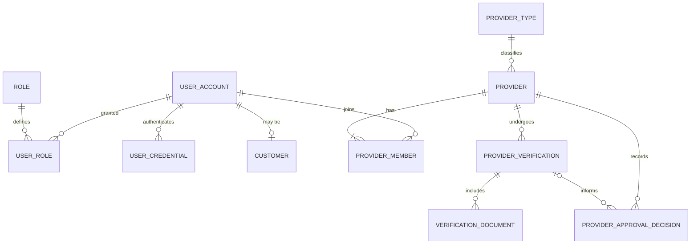
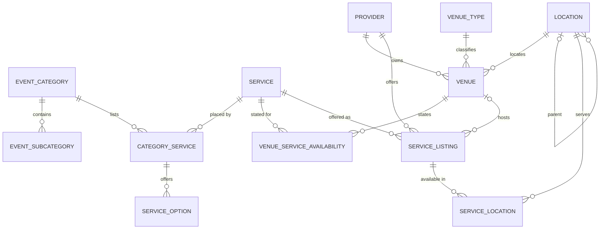
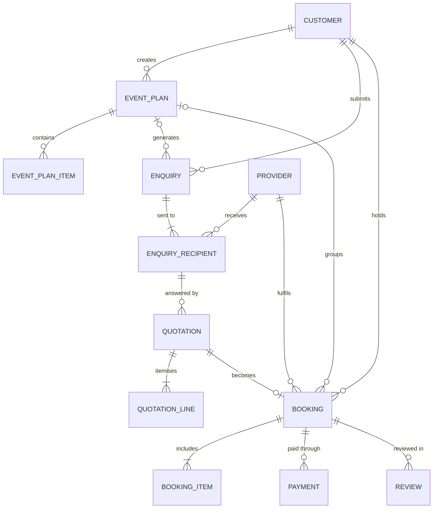
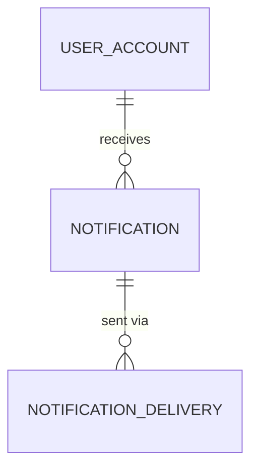

# EVNTGRID — Entity Relationships (Proposed)

| | |
|---|---|
| **Status** | Proposed for owner review. Field-level detail is in `DATABASE_SCHEMA.md`. |
| **Note** | Diagrams use upper-case names in place of `schema.table`. |

## 1. Identity and provider

Role, provider type and approval status are three separate concepts. `USER_ROLE` is on the user, while type and approval status are on the provider (CD-18).

## 2. Catalogue

## 3. Transactions

## 4. Notifications

## 5. Cardinality and delete behaviour

Every foreign key below is RESTRICT unless stated, because business history must not disappear while retention is undecided (U-16).

| From | To | Cardinality | Mandatory | Delete behaviour | Module crossing |
|---|---|---|---|---|---|
| user_role | user_account | Many to one | Yes | CASCADE when an account is removed under an approved process | No |
| user_credential | user_account | Many to one | Yes | CASCADE as above | No |
| customer | user_account | One to one | Yes | RESTRICT | Yes |
| provider_member | user_account | Many to one | Yes | RESTRICT | Yes |
| provider_member | provider | Many to one | Yes | RESTRICT | No |
| provider | provider_type | Many to one | Yes | RESTRICT | No |
| provider_verification | provider | Many to one | Yes | RESTRICT | No |
| verification_document | provider_verification | Many to one | Yes | RESTRICT | No |
| provider_approval_decision | provider | Many to one | Yes | RESTRICT | No |
| event_subcategory | event_category | Many to one | Yes | RESTRICT | No |
| category_service | event_category, service | Many to one | Yes | RESTRICT | No |
| service_option | category_service | Many to one | Yes | CASCADE | No |
| venue | provider | Many to one | Yes | RESTRICT | Yes |
| venue | venue_type, location | Many to one | Yes | RESTRICT | No |
| venue_service_availability | venue | Many to one | Yes | CASCADE | No |
| venue_service_availability | service | Many to one | Yes | RESTRICT | No |
| service_listing | provider | Many to one | Yes | RESTRICT | Yes |
| service_listing | venue | Many to one | No | RESTRICT | No |
| service_location | service_listing | Many to one | Yes | CASCADE | No |
| event_plan | customer | Many to one | Yes | RESTRICT | Yes |
| event_plan_item | event_plan | Many to one | Yes | CASCADE while a draft | No |
| enquiry | customer | Many to one | Yes | RESTRICT | Yes |
| enquiry | event_plan | Many to one | No | RESTRICT | No |
| enquiry_recipient | enquiry | Many to one | Yes | RESTRICT | No |
| enquiry_recipient | provider | Many to one | Yes | RESTRICT | Yes |
| quotation | enquiry_recipient | Many to one | Yes | RESTRICT | Yes |
| quotation_line | quotation | Many to one | Yes | RESTRICT | No |
| booking | quotation | One to one | Yes (U-19) | RESTRICT | Yes |
| booking | customer | Many to one | Yes | RESTRICT | Yes |
| booking_item | booking | Many to one | Yes | RESTRICT | No |
| payment | booking | Many to one | Yes | RESTRICT | Yes |
| review | booking | Many to one | Yes | RESTRICT | Yes |
| notification | user_account | Many to one | Yes | RESTRICT | Yes |
| notification_delivery | notification | Many to one | Yes | CASCADE | No |

Cross-module foreign keys are limited to stable anchors. In code, these references are plain IDs (ADR-003).

## 6. Provider isolation in the data model

Composite foreign keys make it impossible at database level to link one provider's rows with another's (ADR-015).

| Child | Composite key | References |
|---|---|---|
| venue_service_availability | (`venue_id`, `provider_id`) | venue (`id`, `provider_id`) |
| service_listing | (`venue_id`, `provider_id`) | venue (`id`, `provider_id`) |
| service_location | (`listing_id`, `provider_id`) | service_listing (`id`, `provider_id`) |
| verification_document | (`verification_id`, `provider_id`) | provider_verification (`id`, `provider_id`) |
| quotation | (`enquiry_recipient_id`, `provider_id`) | enquiry_recipient (`id`, `provider_id`) |
| booking | (`quotation_id`, `provider_id`) | quotation (`id`, `provider_id`) |

## 7. Where each rule is enforced

| Rule | Database | Application |
|---|---|---|
| Three approval statuses | CHECK | Transition rules in `provider` |
| Two provider types | FK to reference table | — |
| One booking per quotation | Unique | Friendly error handling |
| One accepted quotation per recipient | Partial unique | Acceptance rules |
| Duplicate webhook | Primary key | Idempotent processing |
| Only APPROVED providers publish | Not expressible across modules | `catalog` asks `provider` |
| Administrator holds no other role | Not expressible as a simple constraint | `identity` |
| SR-2 message only from an explicit row | Absence of row | `catalog` |
| SR-3 arrangement only for both food types | CHECK | `enquiry` |
| Sent quotation is immutable | Not enforced | `quotation` domain, and tests |
| Audit is append-only | Database grants | No update path |

## 8. Unresolved rules and their effect on structure

| Rule | Decision | Effect if decided one way | Effect if decided another way |
|---|---|---|---|
| Multi-vendor booking | D-21, U-07 | Per-vendor bookings grouped by plan: no change | Single parent booking: add a parent table |
| Direct booking | U-19 | Quotation-only: no change | `booking.quotation_id` becomes optional and the source needs recording |
| Allow versus provide | D-14 | One state: no change | More status values only |
| SR-2 granularity | D-15 | Service level: optional columns stay empty | Option or event-type level: use the optional columns |
| Availability | D-23, U-09 | Enquiry-based: none or minimal table | Live calendar: new entity with range constraints |
| Suspension | U-04 | Status stays at three values | New value or separate restriction record |
| Publication | U-05 | Publish directly: simple states | Reviewed edits: draft or revision table |
| COMPANY staff | U-02 | Owner only: `member_role` constant | Staff roles: more `member_role` values |
| Dual-role login | U-12 | Allowed: `user_role` already supports it | Disallowed: application rule |
| Payment structure | U-10 | One payment: no change | Instalments, refunds: added entities |
| Reviews | D-28 | Provider-level: no change | Venue and vendor separately: target columns |
| Service merging | D-12 | Data migration only | No structural change |
| Rentals | D-10, U-28 | Marker only | Rental period and deposit fields |
| Service areas | D-30, U-27 | Named areas: no change | Radius: coordinates and possibly a spatial approval |

## Status notes (owner decisions, 2026-11-09)

- **REVIEW** appears in the diagrams for planning only. It is **FUTURE / DEFERRED** (CD-22), not an MVP entity.
- **complaint.support_request** (MVP, minimal, ADR-030) is not drawn. It refers to `customer` and to `catalog` venues or service listings by ID. Whether a database foreign key is added follows the anchor rule in `DATA_OWNERSHIP.md`. Its design is in `DATABASE_SCHEMA.md`, section 11A.
