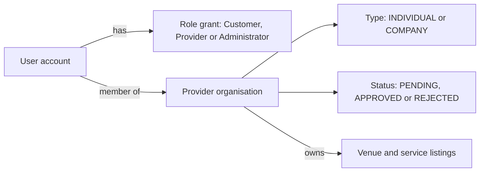

# EVNTGRID — Central Identity and Security

| | |
|---|---|
| **Status** | Architecture baseline for owner review |
| **Labels** | CONFIRMED (`CD`), RECOMMENDED (`AR`), UNRESOLVED (`U`), defined in `APPLICATION_ECOSYSTEM.md` |

## 1. Identity model

Three separate concepts must never be merged (CD-18).

| Concept | Answers | Values | Attached to |
|---|---|---|---|
| **Role** | What kind of user is this? | Visitor, Customer, Provider, Administrator | A user |
| **Provider type** | What legal or business form does this provider have? | INDIVIDUAL, COMPANY | A provider organisation |
| **Approval status** | Is this provider cleared to operate? | PENDING, APPROVED, REJECTED | A provider organisation |

**Consequences**

- COMPANY is never a role. No check says "if role is COMPANY". Authorization checks role, then approval status, then ownership.
- Provider type does not determine what is sold. A COMPANY might be a photography studio, so COMPANY does not mean "event manager". An INDIVIDUAL might own a venue (U-06).
- Approval status belongs to the provider organisation, so it applies equally to everyone acting for it.
- A rejected provider is still a user with the Provider role. It is the approval status that limits what they can do.

Visitor is the absence of a session. It has no account record.

### Central identity (CD-06)

There is one Identity module and one user account store. The other modules hold user IDs and never store credentials.

| Point | Decision | Status |
|---|---|---|
| One person's login holding both Customer and Provider | Technically supported by role grants; product decision pending | U-12 |
| Customer sign-in | Not decided | U-01 |
| Provider sign-in; multiple staff for a COMPANY | Not decided. The membership link above allows it without redesign | U-02 |
| Administrator accounts | Created only by another Administrator, with no self-registration | AR-12 |
| Administrator holding Customer or Provider roles on the same account | Not recommended: separate accounts for separation of duty | AR-12 |
| Sub-permissions within Administrator | Not decided | U-03 |

## 2. Authorization layers

Every protected request passes all relevant layers on the backend (CD-06). Frontend checks only affect what is displayed.

| Layer | Question | Example |
|---|---|---|
| 1. Surface | Is this session valid for this API surface? | A customer session is refused on the admin surface |
| 2. Role | Does the user hold the role? | Only Provider can use provider endpoints |
| 3. Status | Does the provider's state permit this? | Only APPROVED can publish a listing |
| 4. Ownership | Does this record belong to this user or organisation? | Provider reads only enquiries addressed to it |
| 5. Field | Should this field be returned? | Customer contact details withheld until the agreed point (U-21) |

**Ownership rules (recommended)**

- List and detail queries include the owner in the query itself, rather than fetching first and checking after. A record that isn't yours is returned as not found.
- Identifiers are non-sequential, which limits guessing but is not relied upon as a control.
- Administrators bypass ownership only on the admin surface, and their access is audited.
- PostgreSQL row-level security is optional additional protection and is not required for the first release.

### Permission matrix

"Own" means the record belongs to the user or provider organisation.

| Capability | Visitor | Customer | Provider PENDING | Provider APPROVED | Provider REJECTED | Administrator |
|---|---|---|---|---|---|---|
| Browse published catalogue, venues and listings | Yes | Yes | Yes | Yes | Yes | Yes |
| Submit enquiry | U-01 | Yes | No | No | No | No |
| View own enquiries, quotations, bookings | No | Own | No | Own | No | All |
| Accept or decline quotation | No | Own | No | No | No | No |
| Complete onboarding and edit own business profile | No | No | Yes | Yes | U-04 | Support edit, U-03 |
| Create draft listing | No | No | U-05 | Yes | No | U-05 |
| Publish listing | No | No | No | Yes, subject to U-05 | No | Yes, subject to U-05 |
| Set venue service permissions (SR-2) | No | No | U-05 | Own | No | Support edit, U-03 |
| Receive enquiries and send quotations | No | No | No | Own | No | No |
| Approve or reject a provider | No | No | No | No | No | Yes |
| Monitor all transactions; read audit logs | No | No | No | No | No | Yes, subject to U-03 |

### Provider approval and publication (CD-11)

These are backend rules and cannot be set from the frontend.

| Rule | Owner | Status |
|---|---|---|
| New providers start as PENDING | Provider | RECOMMENDED |
| Only an Administrator can change approval status | Provider | CONFIRMED by CD-11 |
| Approval and rejection are recorded with actor and reason | Provider, Audit | CD-13 |
| A listing is publicly visible only when its provider is APPROVED and the listing is published | Catalog, Discovery | RECOMMENDED |
| Clients cannot submit status fields on create or update | API contract | RECOMMENDED |
| An approved provider's later suspension | Not definable with the three approved statuses | U-04 |
| Publication states and review of edits | Not defined | U-05 |

## 3. Authentication across three applications

### 3.1 Session approach (AR-02)

| Option | Assessment |
|---|---|
| **Opaque server-side sessions in Redis (recommended)** | Instant revocation, nothing readable in the browser, and native Spring Security and Spring Session support |
| JWT access and refresh tokens in the browser | Harder to revoke; refresh rotation adds complexity; exposure risk if kept where scripts can read them |
| Separate OAuth2 authorization server | Valuable with third-party clients, but disproportionate here |

Identity remains in PostgreSQL. Redis holds only sessions, and losing it signs people out without losing any account data.

### 3.2 One identity, separate sessions

One account store does not mean one shared login. Each application has its own session and its own cookie.

| Application | Cookie (illustrative) | Idle / absolute timeout |
|---|---|---|
| customer-web | `__Host-evg_c` | To be set, longest of the three |
| provider-portal | `__Host-evg_p` | To be set |
| admin-portal | `__Host-evg_a` | To be set, shortest of the three |

- Each session records its surface. A session is rejected on any other surface, regardless of role.
- The `__Host-` prefix requires Secure, Path=/ and no Domain attribute, so the cookie is sent only to the exact host that set it.
- All session cookies are HttpOnly and Secure, with SameSite=Lax for customer and provider, and SameSite=Strict for admin.
- No cookie is ever set on `.evntgrid.com`. A domain-wide cookie would expose admin sessions to all subdomains.
- The session ID changes at sign-in. Sign-out and password or role changes revoke the relevant sessions.

### 3.3 Sign-in by application

| Application | Method | Status |
|---|---|---|
| customer-web | Undecided (for example phone OTP, email or social) | U-01 |
| provider-portal | Undecided | U-02 |
| admin-portal | Strong credential and mandatory MFA, using Spring Security's MFA support or WebAuthn | AR-12 |

All sign-in, OTP and reset endpoints are rate limited by account and network, with limits held in Redis.

## 4. Network path and CORS (AR-01)

**Recommendation:** each application reaches the backend through its own hostname.

| Browser calls | Routed to |
|---|---|
| `www.evntgrid.com/api/public/*` and `/api/customer/*` | Backend |
| `partner.evntgrid.com/api/provider/*` | Backend |
| `admin.evntgrid.com/api/admin/*` | Backend |

| Benefit | Detail |
|---|---|
| No cross-origin browser calls | CORS has nothing to allow in production |
| Natural session isolation | Each cookie is scoped to its own host |
| Reduced attack surface | The admin API isn't routable from www or partner |

**CORS plan**

| Case | Policy |
|---|---|
| Production with AR-01 | No cross-origin access allowed |
| Local development | Next.js rewrites keep calls same-origin |
| If AR-01 is rejected in favour of `api.evntgrid.com` | Explicit origin allowlist with credentials, never a wildcard, and each session bound to its surface |

The backend derives the surface from the API path. It never trusts a client-supplied header to identify the application.

## 5. CSRF

Session cookies are sent automatically, so state-changing requests need CSRF protection. Spring Security protects unsafe HTTP methods by default.

An important subtlety: `www`, `partner` and `admin` are all **same-site** with each other, so SameSite alone doesn't stop a compromised subdomain from sending requests to another. SameSite is therefore one layer only.

| Layer | Behaviour | Status |
|---|---|---|
| CSRF token | Bound to the server-side session, fetched through a CSRF endpoint, sent in a request header | RECOMMENDED |
| Origin check | `Origin` must exactly match the surface's host on unsafe methods | RECOMMENDED |
| Fetch metadata | Reject unsafe requests unless `Sec-Fetch-Site` is `same-origin` | RECOMMENDED |
| SameSite cookies | Baseline protection from unrelated sites | RECOMMENDED |
| Login forms | Also protected, as sign-in can be attacked too | RECOMMENDED |
| Razorpay webhooks | CSRF does not apply; authenticated by signature | RECOMMENDED |

Spring Security's default BREACH protection is retained. If a cookie-based token is chosen instead of a session-stored one, the configuration differs for JavaScript clients and must follow Spring's single-page application guidance.

## 6. Next.js security rules (AR-20)

| Rule | Reason |
|---|---|
| `proxy.ts` may do optimistic redirects only; never rely on it for authorization | OWASP and Next.js guidance; CVE-2025-29927 allowed middleware-only authorization to be bypassed |
| Backend is the only authorization boundary | CD-06 |
| Server components may read through the API, forwarding the session cookie over the private network | Keeps server rendering subject to the same checks |
| Authenticated responses are never placed in a shared cache | Prevents one user receiving another's data |
| Unsafe operations go to the backend API. If Server Actions are used, they only forward | Server Actions are themselves public endpoints |
| No database client or backend credential in any Next.js project | CD-04, CD-10 |
| Only non-secret values may use the `NEXT_PUBLIC_` prefix | These are shipped to the browser |

## 7. Secrets

| Secret | Location | Never in |
|---|---|---|
| Database, Redis credentials | AWS Secrets Manager, read by backend only | Any frontend |
| Razorpay key secret and webhook secret | AWS Secrets Manager, read by backend only | Any frontend |
| Notification vendor keys | AWS Secrets Manager, read by backend only | Any frontend |
| AWS access | Task IAM roles, with no long-lived keys | Source code |
| Razorpay key ID | May be sent to the browser, since it is public by design | — |

CI scans each repository for secrets on every change. Secrets are rotated on a schedule set during build. When rotating the Razorpay webhook secret, note that retries of older events remain signed with the old secret.

## 8. Secure communication and hardening

| Area | Plan |
|---|---|
| Transport | HTTPS only; HSTS on all hosts; TLS at CloudFront and between CloudFront and origin |
| Origin protection | Backend origin accepts only CloudFront traffic (see `DEPLOYMENT_ARCHITECTURE.md`) |
| Browser headers | Content Security Policy per application, including Razorpay Checkout allowances on customer-web; frame blocking; strict referrer policy |
| Admin perimeter (AR-12) | AWS WAF with IP allowlist or VPN; MFA; shorter sessions; never indexed |
| Uploads | Presigned S3 uploads after backend authorization; type and size checks; separate private bucket for verification documents |
| Input | Validated in the backend against the contract |
| Abuse | WAF and Redis-backed rate limits on sign-in, OTP, enquiry and search |
| Logs | Personal data and tokens are masked |

## 9. Audit logging (CD-13)

**Recommended properties (AR-17)**

- Written in the same transaction as the change, so a change cannot exist without its record.
- Append-only: the application's database role can insert and read, but not update or delete.
- Sensitive values are masked, and contents are limited to what is needed.

| Field | Content |
|---|---|
| When | Timestamp |
| Who | User ID, role, surface; provider organisation if any |
| What | Action name |
| Target | Record type and ID |
| Change | Before and after for relevant fields |
| Context | Correlation ID, source network address, optional reason |

**Events that must be audited**

| Area | Events |
|---|---|
| Identity | Sign-in failures, role changes, administrator creation, MFA changes |
| Provider | Status changes, onboarding document access |
| Catalogue | Taxonomy changes, publication changes, venue permission changes |
| Transactions | Enquiry, quotation, acceptance, booking changes |
| Payment | Status changes and any administrator action |
| Administration | Every administrator write; access to personal or payment data |

Retention is undecided (U-16).

## 10. Security verification

| Check | When |
|---|---|
| Automated tests that one user cannot reach another's record, per endpoint | Every build |
| Automated tests for each cell of the permission matrix | Every build |
| Spring Modulith structure verification | Every build |
| Dependency and secret scanning | Every build |
| Independent penetration test | Before launch |

## 11. Decision status

| Status | Items |
|---|---|
| **CONFIRMED** | Roles (CD-17); type and approval status (CD-18); central identity and backend enforcement (CD-06); secure auth, CORS, CSRF, secrets (CD-10); controlled approval (CD-11); audit (CD-13) |
| **RECOMMENDED** | Same-origin routing (AR-01); server-side sessions (AR-02); admin hardening (AR-12); audit in transaction (AR-17); Next.js rules (AR-20) |
| **UNRESOLVED** | Sign-in methods (U-01, U-02); admin sub-permissions (U-03); provider lifecycle (U-04); publication (U-05); venue owners (U-06); dual-role login (U-12); retention (U-16); contact sharing (U-21) |

## Sources

- [OWASP Next.js Security Cheat Sheet](https://cheatsheetseries.owasp.org/cheatsheets/Nextjs_Security_Cheat_Sheet.html)
- [Spring Security CSRF reference](https://docs.spring.io/spring-security/reference/7.0.7/servlet/exploits/csrf.html)
- [Spring Security: single-page application CSRF considerations](https://docs.spring.io/spring-security/reference/5.8/migration/servlet/exploits.html)
- [InfoQ: multi-factor authentication in Spring Security 7](https://www.infoq.com/news/2025/11/spring-7-spring-boot-4)
- [Razorpay: validate webhooks and secret rotation](https://axisbank-docs.razorpay.com/webhooks/validate-test/)
