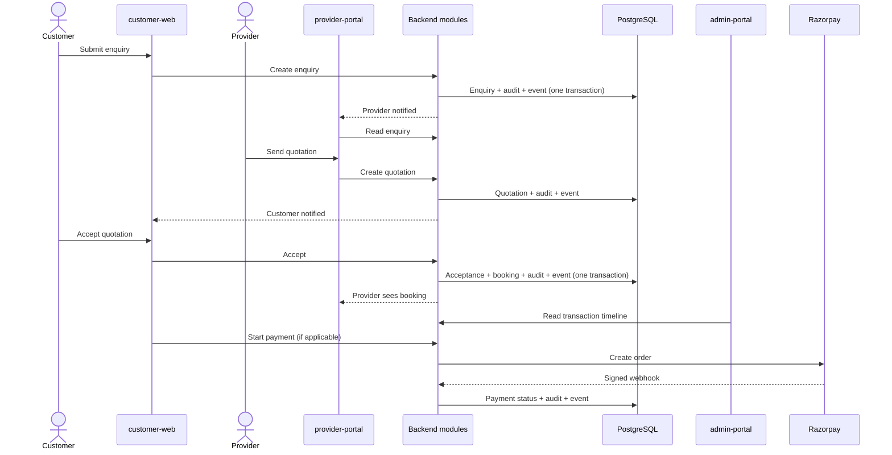

# EVNTGRID — Cross-Application Synchronization

| | |
|---|---|
| **Status** | Architecture baseline for owner review |
| **Labels** | CONFIRMED (`CD`), RECOMMENDED (`AR`), UNRESOLVED (`U`), defined in `APPLICATION_ECOSYSTEM.md` |

## 1. The core idea

The three applications do not synchronize with each other, because they hold no business data of their own. When a customer submits an enquiry, the backend writes one row. The provider and admin applications read that same row.

"Reflected consistently" therefore comes down to three separate jobs:

| Job | Mechanism | Status |
|---|---|---|
| **Truth:** one committed state | A PostgreSQL transaction in the owning module | CONFIRMED (CD-03, CD-05, CD-12) |
| **Reaction:** other modules and notifications respond | Events recorded in the same transaction, processed after commit | RECOMMENDED (AR-07) |
| **Freshness:** open screens show the new state | Frontends refetch from the API | RECOMMENDED (AR-09) |

If a notification is late or a screen is stale, the data is still correct. The next API read returns the truth.

## 2. Mechanisms

### 2.1 Commands and transactions

1. The frontend calls the API.
2. The backend authenticates the session and checks role, approval status and record ownership.
3. The owning module validates the business rule and changes its state.
4. In the same transaction it writes the audit record (AR-17) and publishes domain events.
5. On commit, the state, audit entry and event record all exist. On failure, none do.

### 2.2 Events and background work (AR-07)

Spring Modulith's event publication registry stores an entry for each listener in the same transaction as the business change. A listener's entry is marked complete only when the listener succeeds, so an event cannot be lost by a crash between commit and processing.

| Kind of work | Handled by | Example |
|---|---|---|
| Must succeed with the business change | Direct module call in the same transaction | Create booking on acceptance |
| Internal reaction, can follow shortly | After-commit module listener in its own transaction | Create in-app notification |
| Slow or external | Published to SQS, then consumed by the worker role | Send email or SMS |

Spring Cloud AWS provides the SQS integration for Spring Modulith event externalization. SQS delivery is at-least-once, so every consumer must be safe to run twice.

### 2.3 Freshness on screen (AR-09)

| Situation | Behaviour |
|---|---|
| User performs an action | The response returns the new state and the screen updates immediately |
| User returns to a tab or screen | Data refetches |
| Screen likely to change, such as the quotation list or admin monitor | Background polling while visible, at an interval set during build |
| Unread notifications | Lightweight count endpoint, polled |
| Live push proves necessary | Add server-sent events for those screens, with Redis pub/sub across instances (later) |

WebSockets are not proposed, since these flows are low-frequency and one-directional.

## 3. The transaction flow

## 4. Step-by-step ownership

The sequence is CONFIRMED (CD-19). The mechanism in each step is RECOMMENDED unless stated otherwise. Status names are placeholders until U-08 is settled.

| # | Business event | Starts in | Owning module | Committed result | Visible in |
|---|---|---|---|---|---|
| 1 | Customer submits enquiry | customer-web | **Enquiry** | Enquiry and its recipients | customer-web, provider-portal, admin-portal |
| 2 | Provider receives enquiry | Backend | **Enquiry** (data), **Notification** (alert) | Notification record | provider-portal |
| 3 | Provider sends quotation | provider-portal | **Quotation** | Quotation linked to enquiry | All three |
| 4 | Customer receives quotation | Backend | **Quotation** (data), **Notification** (alert) | Notification record | customer-web |
| 5 | Customer accepts quotation | customer-web | **Quotation** (acceptance state), orchestrated by **Booking** | Accepted quotation | All three |
| 6 | Booking is created | Same transaction as step 5 | **Booking** | Booking with its snapshot | All three |
| 7 | Provider sees the booking | provider-portal | **Booking** (read) | None | provider-portal |
| 8 | Customer sees booking status | customer-web | **Booking** (read) | None | customer-web |
| 9 | Admin monitors the transaction | admin-portal | **Administration** (composes from module APIs) | None | admin-portal |
| 10 | Payment status is reflected | Razorpay webhook | **Payment** | Payment status | All three |

### Step 1 — Customer submits enquiry

- The Enquiry module checks the customer's session, the event details, and that each chosen provider is APPROVED and each listing is published.
- It also applies the venue's service permissions (SR-2). Whether a "does not allow" status blocks the enquiry or only warns is undecided (D-14).
- It stores the enquiry and publishes `EnquirySubmitted`.
- An idempotency key prevents duplicates from a double-click or retry.
- Routing and contact sharing remain open (U-21).

### Step 2 — Provider receives enquiry

The enquiry is immediately queryable by the provider because it is stored against that provider's ID. The API returns only enquiries addressed to the signed-in provider. `EnquirySubmitted` causes Notification to create an in-app alert and queue any outside message. If the alert fails, the enquiry is still in the provider's list.

### Step 3 — Provider sends quotation

- Quotation confirms that the provider is APPROVED, that the enquiry was addressed to it, and that the enquiry is still open.
- It stores the quotation and publishes `QuotationSent`.
- Required contents, validity and revision rules are undecided (D-20).

### Step 4 — Customer receives quotation

Same mechanism as step 2. `QuotationSent` drives the alert. The quotation is available in the customer's list once committed.

### Steps 5 and 6 — Accept quotation and create booking (AR-06)

These run together in one PostgreSQL transaction, because a monolith with one database can guarantee it. An accepted quotation with no booking, or a booking from an unaccepted quotation, cannot exist.

| Protection | Purpose |
|---|---|
| Ownership check | Only the customer who owns the enquiry can accept |
| Rule check inside Quotation | The quotation must still be acceptable |
| Optimistic locking on the quotation | Two simultaneous acceptances cannot both pass |
| Unique constraint: one booking per accepted quotation | Database-level guarantee against duplicates |
| Idempotency key | A retried request returns the original result |
| Snapshot of agreed items and price (AR-19) | Later listing changes cannot alter the booking |

Booking publishes `BookingCreated`. Whether acceptance creates a confirmed booking or one awaiting provider confirmation is undecided (U-08). One booking versus one per vendor is undecided (U-07). Date conflicts are undecided (U-09).

### Steps 7 and 8 — Provider and customer see the booking

Both read the same row through different API surfaces. Each sees only records it owns and only the fields its surface exposes. Notifications are sent by `BookingCreated`. Status always comes from the Booking module, so the two applications cannot disagree.

### Step 9 — Admin monitors the transaction

Administration composes one timeline at read time by calling the public interfaces of Enquiry, Quotation, Booking and Payment, joined by a correlation ID, and adds entries from Audit. It keeps no copy of the transaction. Any admin intervention goes through the owning module's own rules and is audited.

If timeline queries become slow, a read-only projection or SQL view can be added. It remains derived and is never written to by users.

### Step 10 — Payment status is reflected

Razorpay is CONFIRMED as the gateway. **Whether payment occurs, when, how much and to whom are undefined (U-10), and this document does not assume them.** The technical path below applies whenever a payment exists.

| Stage | Behaviour |
|---|---|
| Start | Backend creates the Razorpay order. Only the public key ID reaches the browser. |
| Checkout | The customer pays in Razorpay Checkout. |
| Browser callback | Backend verifies the signature and shows "processing". This is a progress signal, not the final status (AR-13). |
| Webhook intake | Verify `X-Razorpay-Signature` against the **raw** request body. Reject if invalid. |
| Duplicate protection | Record `x-razorpay-event-id` under a unique constraint. Razorpay delivers at least once, so repeats are expected. |
| Acknowledgement | Return 2xx only after the event is durably stored; do slower work after that. Razorpay treats non-2xx as failure and retries with backoff for 24 hours. |
| Ordering | Webhooks can arrive out of order. Payment status moves only forward in a defined state machine; late events do not regress it. |
| Reconciliation | A scheduled worker job checks unresolved payments against Razorpay to recover missed webhooks. |

Payment is the only owner of payment status. Booking does not store a copy. An API response showing a booking and its payment summary is composed at read time by a thin query layer above both modules, so Booking never depends on Payment.

Payment publishes `PaymentStatusChanged`. Payment already depends on Booking, so if a payment must change a booking, Payment calls Booking's public interface. Booking listening to a Payment event would create a dependency cycle that Spring Modulith rejects. What that change should be is business policy and is undefined (U-08, U-10).

## 5. Domain events

Names are illustrative. Payloads carry IDs and only the minimum necessary data.

| Event | Published by | Consumers |
|---|---|---|
| `ProviderApproved`, `ProviderRejected` | Provider | Catalog, Discovery, Notification |
| `ListingPublished`, `ListingUnpublished` | Catalog | Discovery, Notification |
| `EnquirySubmitted` | Enquiry | Notification |
| `QuotationSent` | Quotation | Notification |
| `QuotationAccepted`, `BookingCreated` | Quotation, Booking | Notification, Discovery (if availability is affected) |
| `BookingStatusChanged` | Booking | Notification. Review (FUTURE / DEFERRED, subject to D-28) would also consume it |
| `PaymentStatusChanged` | Payment | Notification |

Audit is deliberately **not** an event consumer: the record is written inside the transaction (AR-17).

## 6. Who sees what

| Record | customer-web | provider-portal | admin-portal | Owner |
|---|---|---|---|---|
| Enquiry | Own | Addressed to the provider | All | Enquiry |
| Quotation | Received | Own | All | Quotation |
| Booking | Own | Own | All | Booking |
| Payment status | Own | Summary, scope to be set (U-10) | All | Payment |
| Provider approval status | Never directly; only published listings appear | Own | All | Provider |
| Audit records | Never | Never | Permitted administrators | Audit |

## 7. Failure handling

| Failure | Result | Recovery |
|---|---|---|
| Crash during a command | Transaction rolls back; nothing changed | User retries; idempotency key protects |
| Crash after commit, before a listener runs | Event remains recorded as incomplete | Worker resubmits incomplete publications |
| Listener fails | Event remains incomplete or failed | Retries, then alert for investigation |
| SQS consumer fails repeatedly | Message moves to a dead-letter queue | Alarm and manual redrive |
| Duplicate message | Consumer detects it and does nothing further | By design |
| Two users change one record | Second gets a conflict | Screen reloads the latest state |
| Webhook lost | Status remains processing | Reconciliation job |
| Redis unavailable | Sessions and cached reads affected; no business data lost | Service restoration; users may need to sign in again |

With several instances sharing the registry, only the worker should resubmit incomplete publications, under a lock. Automatic republishing on every instance restart should remain off, since it could reprocess work running on another instance.

## 8. Decision status

| Status | Items |
|---|---|
| **CONFIRMED** | Sequence (CD-19); consistency (CD-12); one record (CD-05); background processing (CD-14); Razorpay (CD-16) |
| **RECOMMENDED** | Atomic acceptance (AR-06); outbox and SQS (AR-07); refetch first (AR-09); webhook authority (AR-13); audit in transaction (AR-17) |
| **UNRESOLVED** | Statuses and confirmation (U-08); multi-vendor structure (U-07); availability (U-09); payment policy (U-10); routing and contact sharing (U-21); notification vendors (U-13); polling intervals and freshness targets (U-15) |

## Sources

- [Spring Modulith: events and the event publication registry](https://docs.spring.io/spring-modulith/reference/2.0.3/events.html)
- [Spring Modulith configuration appendix](https://docs.spring.io/spring-modulith/reference/2.1/appendix.html)
- [What's new in Spring Modulith 1.3: SQS moved to Spring Cloud AWS](https://spring.io/blog/2024/11/22/whats-new-in-spring-modulith-1-3)
- [Razorpay webhook best practices](https://razorpay.com/docs/webhooks/best-practices/)
- [Razorpay: validate and test webhooks](https://razorpay.com/docs/webhooks/validate-test.md)
- [Razorpay webhook delivery guide](https://razorpay.com/blog/?p=28285)
