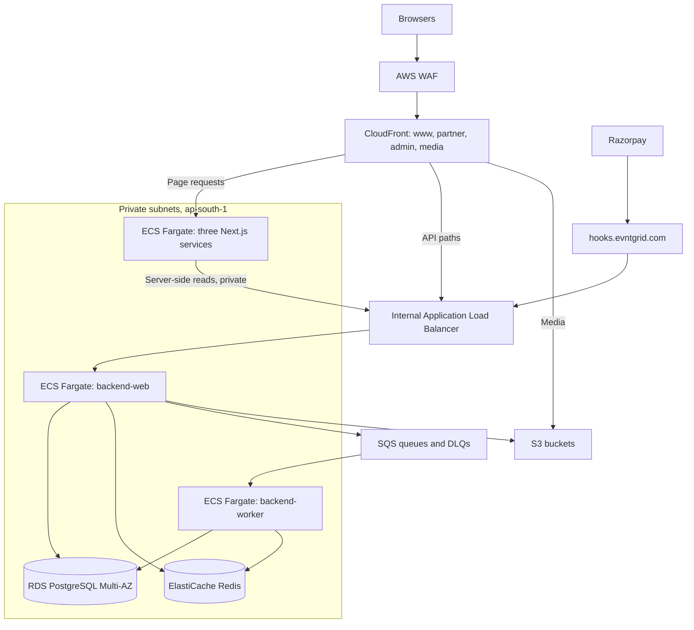

# EVNTGRID — Deployment Architecture

| | |
|---|---|
| **Status** | Architecture baseline for owner review |
| **Labels** | CONFIRMED (`CD`), RECOMMENDED (`AR`), UNRESOLVED (`U`), defined in `APPLICATION_ECOSYSTEM.md` |
| **Note** | The owner confirmed AWS services for messaging, storage and CDN, but not where the applications or database are hosted. The hosting design here is a recommendation (AR-10, U-17). |

## 1. Deployment units

Five runtime services are built from four codebases, all in one repository (CD-21).

| Service | From | Purpose | Deploys independently? |
|---|---|---|---|
| customer-web | `frontend/customer-web` in the repository | Public marketplace | Yes (CD-01) |
| provider-portal | `frontend/provider-portal` in the repository | Provider application | Yes (CD-01) |
| admin-portal | `frontend/admin-portal` in the repository | Administration | Yes (CD-01) |
| backend-web | `backend` in the repository, web role | REST APIs and webhooks | One backend release |
| backend-worker | Same backend artifact, worker role | SQS consumers, scheduled jobs, event resubmission | One backend release |

The web and worker roles are one artifact, one version and one database, and run as a modular monolith (CD-02, AR-08). They are not microservices.

## 2. Topology (AR-10)

| Layer | Recommendation | Reason |
|---|---|---|
| Region | AWS Mumbai (`ap-south-1`) | Closest to Indian users; simplifies any data-location needs (U-16) |
| CDN and edge | CloudFront with WAF | CloudFront is CD-16 |
| Next.js hosting | ECS Fargate in standalone containers | One operating model, private network path to the backend. Alternatives: AWS Amplify, Vercel |
| Backend hosting | ECS Fargate | No servers to manage; separate scaling per role |
| Database | RDS for PostgreSQL, Multi-AZ | Managed failover and backups. Aurora is an alternative |
| Redis | ElastiCache | Managed; Multi-AZ for production |
| Queues | SQS standard queues, each with a dead-letter queue | At-least-once delivery matches idempotent consumers |
| Secrets | AWS Secrets Manager with IAM task roles | CD-10 |
| DNS and certificates | Route 53 and ACM; CloudFront certificates are issued in `us-east-1` | Standard CloudFront requirement |

## 3. Hostnames and routing

| Hostname | Status | Purpose |
|---|---|---|
| www.evntgrid.com | CONFIRMED as proposed (CD-20) | customer-web |
| partner.evntgrid.com | CONFIRMED as proposed (CD-20) | provider-portal |
| admin.evntgrid.com | CONFIRMED as proposed (CD-20) | admin-portal |
| evntgrid.com | RECOMMENDED | Redirect to www |
| media.evntgrid.com | RECOMMENDED | Public images through CloudFront |
| hooks.evntgrid.com | RECOMMENDED | Razorpay webhooks only |

Ownership of the domain has not been verified (U-18).

### CloudFront behaviour by host (AR-01)

| Host | Path | Goes to | Caching |
|---|---|---|---|
| www | `/_next/static/*` | customer-web | Long-lived, immutable |
| www | `/api/public/*` | Backend | Short TTL on GET; cookies excluded from cache key |
| www | `/api/customer/*` | Backend | None |
| www | Everything else | customer-web | By page. Never for personalised pages |
| partner | `/api/provider/*` | Backend | None |
| partner | Everything else | provider-portal | None, except static assets |
| admin | `/api/admin/*` | Backend | None |
| admin | Everything else | admin-portal | None, except static assets |

A request for `/api/admin/*` on www falls through to customer-web and never reaches the backend. WAF rules can differ per hostname; admin carries the IP restriction (AR-12).

**Origin protection.** Preferred: an internal load balancer reached through a CloudFront VPC origin, so the backend has no public address. Next.js servers use the same internal load balancer for server-side reads, and those requests still need a valid session for the surface they call.

**Webhooks.** `hooks.evntgrid.com` is served through CloudFront, forwards only the webhook path, keeps the raw body unchanged, and can apply Razorpay's published webhook source IP list in WAF.

## 4. Network rules

| From | To | Allowed |
|---|---|---|
| Internet | Next.js or backend directly | No. CloudFront only |
| Next.js | PostgreSQL, Redis, SQS | **No route (CD-04)** |
| Next.js | Backend (internal load balancer) | Yes, for server-side reads |
| backend-web, backend-worker | PostgreSQL, Redis | Yes |
| backend-web, backend-worker | SQS, S3, Secrets Manager | Yes, by IAM role, through VPC endpoints where practical |
| backend-web, backend-worker | Razorpay and notification vendors | Outbound via NAT |

## 5. Background processing (CD-14)

| Queue (illustrative) | Purpose |
|---|---|
| `notifications` | Email, SMS and WhatsApp sending (vendors: U-13) |
| `media-processing` | Image resizing and validation |
| `payment-events` | Slower processing after webhook receipt, if needed |

Each queue has a dead-letter queue and an alarm.

| Scheduled job (worker) | Purpose |
|---|---|
| Event resubmission | Retry incomplete Spring Modulith event publications |
| Payment reconciliation | Compare unresolved payments with Razorpay |
| Quotation expiry | Only when a validity rule exists (D-20) |
| Housekeeping | Clear completed event records and expired artefacts |

Scheduled jobs use a database lock, so only one worker runs each job. After-commit in-process listeners run on the backend-web instance that handled the request; the worker handles queues and recovery.

## 6. Build and release

### Repository (CD-21, replaces AR-15)

**Owner decision:** one Git repository, rooted at the project folder (any location), holds the backend, the three frontends, infrastructure, documentation and scripts. The earlier recommendation of four repositories (AR-15) is superseded.

| Rule | Detail |
|---|---|
| One repository | One root `.git` and one root `.gitignore`. No nested repositories inside `frontend/*` or `backend`. Generators are run with the option that stops them creating a repository |
| Independent releases | Each application still builds, tests and deploys on its own (CD-01). A change in one frontend must not rebuild or release the others |
| Pipelines | One pipeline per application with path filters, so only changed applications build. The pipeline tool is still undecided (TA-14) |
| No shared frontend code | The three frontends share no code package (CD-07). Each has its own `package.json`. To avoid installing the same packages three times, `frontend/package.json` makes them one npm workspace with one `frontend/package-lock.json` and one `frontend/node_modules` (2026-11-15). Pipelines and Dockerfiles therefore run `npm ci` in `frontend` and then build one application with `-w <app>` |
| Dockerfiles | Location undecided (U-30) |

### Pipelines

| Stage | Frontends | Backend |
|---|---|---|
| Verify | Lint, type check, tests, secret scan | Unit tests, Modulith structure verification, security tests, secret scan |
| Contract | Build against released client | Generate OpenAPI, breaking-change check |
| Package | Container image | Container image, one per version |
| Staging | Deploy, smoke test | Migrate, deploy, integration test |
| Production | Rolling deployment with health checks | Migrate, deploy web and worker, smoke test |

### Migrations (AR-16)

Spring Modulith can run Flyway at startup, but several instances starting at once makes this a poor production choice. Run Flyway as **one dedicated deployment task** before the new version starts.

| Phase | Action |
|---|---|
| Expand | Add new columns or tables; old code still works |
| Deploy | Release code that works with both shapes |
| Migrate data | Backfill in batches |
| Contract | In a later release, remove what is unused |

### Release compatibility

Because the frontends release independently, the backend must always stay compatible with the live frontend versions. The backend releases first when a contract changes. Next.js also needs consistent build IDs across its running instances to avoid mismatched assets during a rollout.

## 7. Environments

| Environment | Purpose | Data | Razorpay |
|---|---|---|---|
| Local | Development | Containers or test data | Test mode |
| Development (optional) | Integration | Synthetic | Test mode |
| Staging | Production-like release check | Synthetic or anonymised only | Test mode |
| Production | Live | Real | Live mode |

Production should be in a separate AWS account from non-production (U-17). Each environment has its own secrets, domains and Razorpay credentials.

## 8. Availability and scaling

| Component | Initial approach | Grows by |
|---|---|---|
| Next.js services | Two tasks each, across zones | Horizontal scaling per application |
| backend-web | Two or more tasks, across zones | Horizontal scaling on CPU and latency |
| backend-worker | One or more tasks | Scaling on queue depth |
| PostgreSQL | Multi-AZ primary | Larger instance, read replicas for reporting and read models, partition high-volume tables |
| Redis | Primary and replica | Larger node, then cluster |

Spring Boot web instances are stateless, since sessions are in Redis. Connection pools are sized against the PostgreSQL connection limit, and virtual threads on Java 25 do not remove that limit.

The first bottleneck is likely to be the single database. It is a trade-off accepted under CD-03, and the mitigations above extend it a long way.

## 9. Operations

| Area | Plan |
|---|---|
| Logs | Structured JSON in CloudWatch, with correlation IDs and masked personal data |
| Metrics | Spring Boot Actuator and CloudWatch; Actuator is private |
| Tracing | OpenTelemetry through backend; extend to Next.js servers if useful |
| Alarms | Error rates, latency, queue depth, dead-letter messages, incomplete events, failed webhooks, database health |
| Business monitors | Stuck enquiries, unreconciled payments |
| Backups | RDS automated backups and point-in-time recovery; S3 versioning; restores are tested |
| Disaster recovery | Multi-AZ within the region. Cross-region recovery depends on targets (U-15) |
| Runbooks | Razorpay secret rotation, dead-letter redrive, database restore, session store loss |

## 10. Suggested rollout order

Subject to U-11:

1. Accounts, networking, CI and environments
2. Backend skeleton with Identity, Audit and module verification
3. Provider and Catalog, with the minimum admin-portal screens needed to approve and publish
4. Discovery and customer-web browsing
5. Enquiry, Quotation and Booking across all three applications
6. Payment, once U-10 is decided
7. Hardening, penetration test, launch

Note that step 3 pulls part of admin-portal ahead of the customer features, since nothing can be published without it.

## 11. Decision status

| Status | Items |
|---|---|
| **CONFIRMED** | Three deployable frontends (CD-01); one backend (CD-02); one PostgreSQL (CD-03); Maven and backend stack (CD-15); Redis, SQS, S3, CloudFront, Razorpay (CD-16); proposed hostnames (CD-20) |
| **RECOMMENDED** | AWS Mumbai with ECS Fargate, RDS and ElastiCache (AR-10); web and worker roles (AR-08); routing by host (AR-01); one repository (CD-21); migration approach (AR-16) |
| **UNRESOLVED** | AWS accounts and final hosting (U-17); capacity, service levels, RPO and RTO (U-15); domain (U-18); build order (U-11); notification vendors (U-13); version pins (U-20); data location (U-16) |

## Sources

- [Spring news roundup, Oct 2025: Flyway migrations on startup in Spring Modulith](https://www.infoq.com/news/2025/10/spring-news-roundup-oct20-2025)
- [Razorpay webhook best practices: whitelisting webhook IPs](https://razorpay.com/docs/webhooks/best-practices.md)
